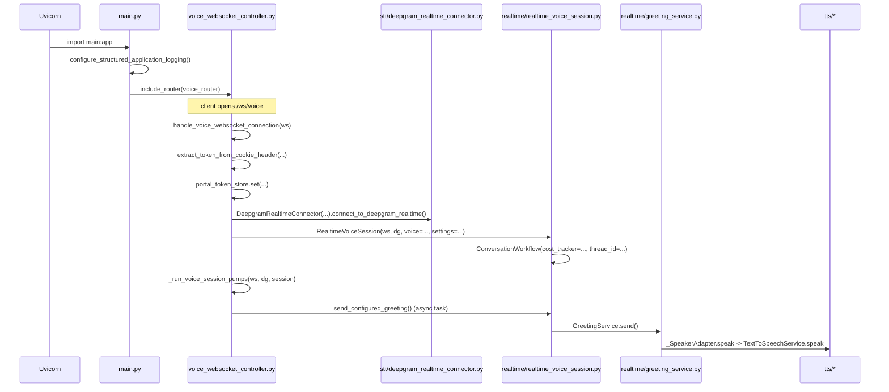
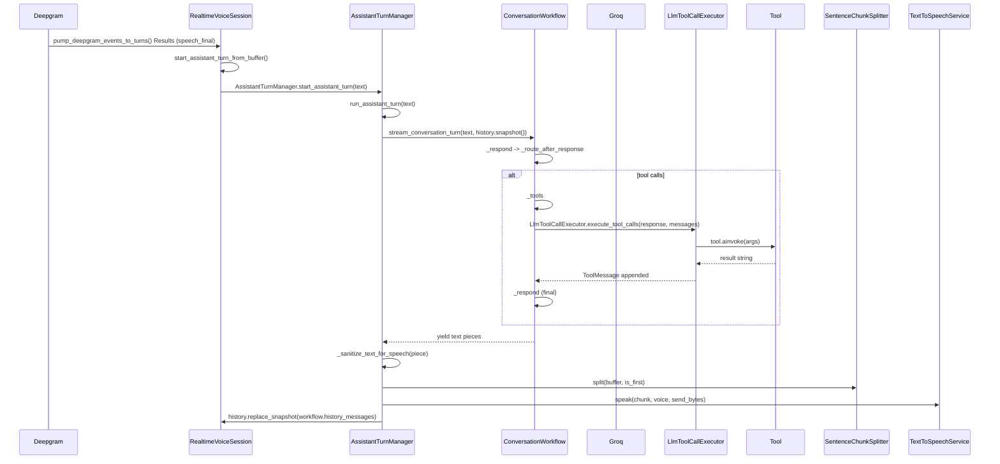
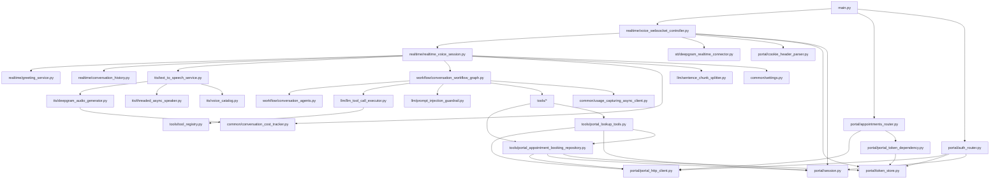
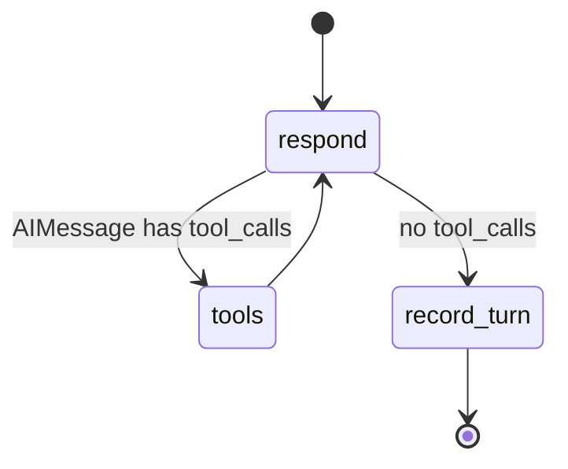
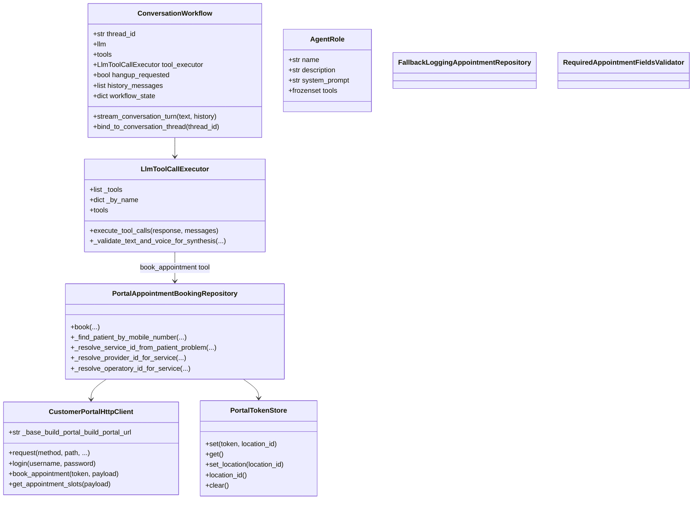

# ARCHITECTURE.md

Backend root: `/backend`. Voice dental-clinic agent: browser websocket -> Deepgram STT -> LangGraph workflow -> Groq LLM + tools -> customer-portal REST API -> Deepgram TTS.

## 1. OVERVIEW

One call flows like this: the browser opens `/ws/voice`; `voice_controller.handle_voice_websocket_connection` accepts, connects Deepgram STT, and builds a `RealtimeVoiceSession`. `RealtimeVoiceSession` sends a greeting via `GreetingService`, then pumps browser audio to Deepgram and Deepgram events back to the client. On a final STT utterance, `RealtimeVoiceSession.start_assistant_turn_from_buffer` schedules `AssistantTurnManager.run_assistant_turn`, which calls `ConversationWorkflow.stream_conversation_turn` (LangGraph). The graph selects an `AgentRole`, invokes Groq (possibly with scoped tools), executes tools through `LlmToolCallExecutor`, and returns spoken text. `AssistantTurnManager` sanitizes and chunks that text with `SentenceChunkSplitter`, synthesizes each chunk through `TextToSpeechService`/`ThreadedTextToSpeechSpeaker`/`DeepgramAudioGenerator`, and sends PCM bytes to the browser. Booking turns call `PortalAppointmentBookingRepository.book`, which resolves patient/service/provider/operatory/slots through `CustomerPortalHttpClient` and returns a confirmation string. Cost usage is captured in `ConversationCostTracker`; on disconnect it prints a summary.

## 2. FOLDER TREE

```text
backend/
├── main.py                                 FastAPI app, logging, CORS, router registration
└── modules/
    ├── common/
    │   ├── conversation_cost_tracker.py                         Per-conversation STT/TTS/LLM cost tracker
    │   ├── backend_contracts.py                     Small ABCs/protocols for DIP/ISP
    │   └── settings.py                      Central env-backed Settings + cached getter
    ├── llm/
    │   ├── sentence_chunk_splitter.py                      Sentence-aware splitter for streaming TTS
    │   ├── llm_error_classification.py                        Tool validation error classifier
    │   ├── prompt_injection_guardrail.py                    Regex prompt-injection guardrail
    │   ├── redact.py                                           PII redaction helper
    │   ├── emergency.py                                        Deterministic emergency triage
    │   ├── call_context.py                                      call_id ContextVar + JSON logging
    │   ├── tracing.py                                           Optional LangSmith tracing
    │   └── usage_capturing_async_client.py                       Groq usage-capturing async client
    │   └── llm_tool_call_executor.py                 Dispatches model tool calls + booking validation
    ├── portal/
    │   ├── appointments_router.py           /api/appointments proxies
    │   ├── auth_router.py                    /api/auth login/logout/me
    │   ├── portal_http_client.py                        Customer-portal HTTP client + audit logging
    │   ├── cookie_header_parser.py                       Cookie-header parser for WS handshake
    │   ├── portal_token_dependency.py                          FastAPI portal-token dependency
    │   ├── dtos.py                          Portal request DTOs/enums/validators
    │   ├── errors.py                        PortalApiError/Auth/Network types
    │   ├── session.py                       JWT location resolution + slot location encryption
    │   └── token_store.py                   Per-session portal JWT/location holder (ContextVar)
    ├── sip/
    │   └── sip_credentials_router.py            Authenticated /api/sip/credentials endpoint
    ├── realtime/
    │   ├── greeting_service.py                      One-shot welcome message service
    │   ├── conversation_history.py                       Bounded in-memory conversation history
    │   ├── realtime_voice_session.py                       WebSocketMessagePublisher, PendingTranscriptBuffer, AssistantTurnManager, RealtimeVoiceSession
    │   └── voice_websocket_controller.py              /ws/voice route + session pump supervision
    ├── stt/
    │   └── deepgram_realtime_connector.py                     Deepgram realtime websocket connector
    ├── tools/
    │   ├── __init__.py                      Imports registry + tool modules (registration)
    │   ├── appointment_booking_tool.py                   LangChain book_appointment tool + handler factory
    │   ├── portal_appointment_booking_repository.py             Real booking repository (portal API)
    │   ├── portal_lookup_tools.py                  Lookup tools (patient/services/providers/slots/appts)
    │   ├── tool_registry.py                      Shared TOOL_REGISTRY list
    │   └── fallback_appointment_repository.py                    Fallback logging repository + strict validator
    ├── tts/
    │   ├── deepgram_audio_generator.py                     Blocking Deepgram audio generator
    │   ├── threaded_async_speaker.py                        Async bridge for blocking TTS iterator
    │   ├── text_to_speech_service.py                    TTS facade (validate + generate + speak)
    │   └── voice_catalog.py                         Voice catalogue + validator
    └── workflow/
        ├── __init__.py                      Exports agents/workflow
        ├── conversation_agents.py                         AgentRole definitions + router/context builder
        └── conversation_workflow_graph.py                          LangGraph ConversationWorkflow + state machine
```

Empty package `__init__.py` files (`common/`, `portal/`) are omitted above; they contain package docstrings/exports only.

## 3. FILE-BY-FILE REFERENCE

### `backend/main.py`

- **Purpose**: FastAPI entry point, structured logging, CORS, router registration, health endpoint.
- **Public symbols**: `configure_structured_application_logging() -> None`; `app: FastAPI`; `health() -> dict`; `start_assistant_turn() -> None`.
- **Project imports**: `modules.portal.appointments_router`, `modules.portal.auth_router`, `modules.realtime.voice_websocket_controller`.
- **Used by**: `uvicorn main:app` / `python main.py`.
- **External/config**: hardcoded CORS origins (`localhost:3000`, `:8000`), port `8000`, reload enabled.

### `modules/common/conversation_cost_tracker.py`

- **Purpose**: Accumulate per-session STT/TTS/LLM usage and estimated cost.
- **Public**: `ConversationCostTracker(settings: Settings)`; `add_stt_audio(byte_count: int, sample_rate: int) -> None`; `add_tts_text(text: str, model: str) -> None`; `add_llm_usage(usage: Mapping, model: str) -> None`; `print_summary() -> None`.
- **Project imports**: `modules.common.settings.Settings`.
- **Used by**: `modules.realtime.realtime_voice_session.RealtimeVoiceSession`; ``modules.tts.deepgram_audio_generator.DeepgramAudioGenerator`; `modules.tts.text_to_speech_service.TextToSpeechService` (passes tracker); `modules.workflow.conversation_workflow_graph.ConversationWorkflow`.
- **External/config**: prices in `Settings` (Groq input/cached/output, Deepgram STT per minute, TTS per 1000 chars).

### `modules/common/backend_contracts.py`

- **Purpose**: ABCs for DIP/ISP.
- **Public**: `Guardrail`, `LlmAssistant`, `ChunkSplitter`, `RealtimeConnector`, `VoiceValidator`, `AsyncSpeaker`, `AppointmentRepository`, `AppointmentValidator`, `MessagePublisher`, `ConversationHistory`.
- **Project imports**: none.
- **Used by**: `chunking`, `guard_rail`, `llm_service`, `stt.connector`, `tts.voices`, `tts.speaker` (via callable), `tools.repository`, `tools.portal_repository`, `realtime.greeting`, `realtime.history`, `realtime.session`.
- **External/config**: none.

### `modules/common/settings.py`

- **Purpose**: Load env files once; define frozen `Settings`; cached accessor.
- **Public**: `_load_env_once()`; `_as_bool(value, default=False) -> bool`; `Settings` dataclass; `get_settings() -> Settings` (lru_cached).
- **Project imports**: none.
- **Used by**: nearly all modules.
- **External/config**: env vars listed in section 7(c).

### `modules/llm/sentence_chunk_splitter.py`

- **Purpose**: Sentence-aware chunking for streaming TTS.
- **Public**: `SENTENCE_END`, `FIRST_CHUNK_CHARS=36`, `LATER_CHUNK_CHARS=160`; `SentenceChunkSplitter(first_chars=..., later_chars=...)`; `split(buffer: str, is_first: bool) -> tuple[str, str]`.
- **Project imports**: `modules.common.backend_contracts.ChunkSplitter`.
- **Used by**: `modules.realtime.realtime_voice_session.AssistantTurnManager` (default splitter).
- **External/config**: none.

### `modules/llm/llm_error_classification.py`

- **Purpose**: Classify Groq tool-call validation failures.
- **Public**: `is_tool_validation_error(error: Exception) -> bool`.
- **Project imports**: none.
- **Used by**: ``modules.workflow.conversation_workflow_graph.ConversationWorkflow._respond`.
- **External/config**: none.

### `modules/llm/prompt_injection_guardrail.py`

- **Purpose**: Regex prompt-injection guardrail.
- **Public**: `INJECTION_PATTERNS: list[str]`; `RegexInjectionGuardrail(patterns=None)`; `is_injection(user_message: str) -> bool`; `is_allowed(text: str) -> bool`.
- **Project imports**: `modules.common.backend_contracts.Guardrail`.
- **Used by**: ``modules.workflow.conversation_workflow_graph.ConversationWorkflow`.
- **External/config**: none.


- **Purpose**: Groq LLM assistant implementing `LlmAssistant` (guardrail -> tool stream_conversation_turn -> final stream_conversation_turn); currently not instantiated by runtime (see known issues).
- **Public**: constants `SYSTEM_PROMPT`, `OUT_OF_SCOPE_REPLY`; `_normalize_message_content_to_text(content) -> str`; `_stream_plain_llm_response(llm, messages, **kwargs)` async generator; `_UsageCapturingAsyncClient`; `GroqLlmAssistant.__init__(model=None, llm=None, guardrail=None, tool_executor=None, system_prompt=SYSTEM_PROMPT, cost_tracker=None)`; `_messages(text, history=None) -> list`; `stream_conversation_turn(text, history=None) -> AsyncIterator[str]`.
- **Project imports**: `modules.common.conversation_cost_tracker`, `modules.common.backend_contracts`, `modules.common.settings`, `modules.llm.llm_error_classification`, `modules.llm.prompt_injection_guardrail`, `modules.llm.llm_tool_call_executor`.
- **Used by**: documented as `LlmAssistant` implementation; grep shows no runtime caller.
- **External/config**: Groq `ChatGroq`, env `GROQ_MODEL`, `LLM_MAX_TOKENS`.

### `modules/llm/llm_tool_call_executor.py`

- **Purpose**: Execute model-requested tools; special-case booking validation.
- **Public**: `LlmToolCallExecutor(tools=None)`; property `tools -> list`; `execute_tool_calls(response, messages) -> None`; `_validate_and_execute_booking(tool_call, tool_args, messages) -> None`.
- **Project imports**: lazy `modules.tools.TOOL_REGISTRY`.
- **Used by**: ``modules.workflow.conversation_workflow_graph.ConversationWorkflow`.
- **External/config**: none.

### `modules/portal/appointments_router.py`

- **Purpose**: FastAPI appointment proxies.
- **Public**: `router: APIRouter` (prefix `/api/appointments`); `_dto_error(message) -> JSONResponse`; `list_appointments(...)`, `appointment_details(...)`, `book_appointment(...)`.
- **Project imports**: `modules.portal.portal_http_client`, `modules.portal.portal_token_dependency`, `modules.portal.dtos`.
- **Used by**: `main.py`.
- **External/config**: portal via `CustomerPortalHttpClient`.

### `modules/portal/auth_router.py`

- **Purpose**: Portal login/logout/me and cookie mirroring.
- **Public**: `router: APIRouter` (prefix `/api/auth`); `PortalLoginRequest`; `_set_portal_cookie(response, token)`; `login(...)`, `logout(...)`, `me(...)`.
- **Project imports**: `modules.common.settings`, `modules.portal.portal_http_client`, `modules.portal.portal_token_dependency`, `modules.portal.errors`, `modules.portal.session`, `modules.portal.token_store`.
- **Used by**: `main.py`.
- **External/config**: portal auth endpoints, cookie settings.

### `modules/portal/portal_http_client.py`

- **Purpose**: Async customer-portal HTTP client, envelope handling, logging, caching.
- **Public**: `_ApiCallLog`; `CustomerPortalHttpClient(...)`; `_build_portal_build_portal_url`, `_raise_portal_error_for_envelope`, `request`, `aclose`; auth `login`, `get_token_details`; appointments `list_appointments` (defined twice), `get_appointment_details`, `book_appointment`, `get_providers`, `get_appointment_master_data`, `get_procedure_master_list`, `get_patient_list_data`, `create_patient`; lookups `get_services`, `get_appointment_slots`; patients `patient_by_mobile`; module functions `set_api_audit`, `reset_api_audit`, `get_shared_portal_http_client`.
- **Project imports**: `modules.common.settings`, `modules.portal.dtos`, `modules.portal.errors`.
- **Used by**: `appointments_router`, `auth_router`, `portal_repository`, `portal_lookup_tools`, `session`.
- **External/config**: `PORTAL_BASE_URL`, `PORTAL_TIMEOUT`, `API_LOG_BODIES`.

### `modules/portal/cookie_header_parser.py`

- **Purpose**: Parse raw Cookie header.
- **Public**: `extract_token_from_cookie_header(header, cookie_name) -> Optional[str]`.
- **Project imports**: none.
- **Used by**: `modules.realtime.voice_websocket_controller.handle_voice_websocket_connection`.
- **External/config**: none.

### `modules/portal/portal_token_dependency.py`

- **Purpose**: Resolve portal token from cookie/store.
- **Public**: `resolve_portal_token_from_request(request) -> str`.
- **Project imports**: `modules.common.settings`, `modules.portal.token_store`.
- **Used by**: `appointments_router`, `auth_router`.
- **External/config**: `PORTAL_COOKIE_NAME`.

### `modules/portal/dtos.py`

- **Purpose**: Typed portal request DTOs, enums, validation/serialization.
- **Public**: enums `AppointmentStatusType`, `AppointmentSource`, `AppointmentListStatus`, `AppointmentSortKey`, `AppointmentSortValues`, `SlotViewType`; `DtoValidationError`; `PortalDto`; DTOs `AppointmentBookRequestDTO`, `GetAppointmentSlotsRequestDto`, `AppointmentsFiltersDto`, `AppointmentsListRequestDTO`, `GetServiceByLocationIdRequestDto`, `GetAppointmentDetailsByIdRequestDTO`, `GetPatientDetailsByMobileNumberRequestDto`.
- **Project imports**: none.
- **Used by**: `appointments_router`, `client`, `portal_repository`, `portal_lookup_tools`.
- **External/config**: none.

### `modules/portal/errors.py`

- **Purpose**: Portal error types and flattening.
- **Public**: `flatten_portal_error_details(value) -> str`; `PortalApiError`; `PortalAuthError`; `PortalNetworkError`.
- **Project imports**: none.
- **Used by**: `auth_router`, `client`, `portal_repository`, `portal_lookup_tools`, `session`.
- **External/config**: none.

### `modules/portal/session.py`

- **Purpose**: Resolve active location id from JWT/store/token-details; encrypt location id for slot endpoint.
- **Public**: `extract_location_id_from_jwt(token) -> Optional[str]`; `resolve_active_location_id(token, client=None, store=None) -> str`; `encrypt_location_id_for_portal_for_portal(location_id) -> str`.
- **Project imports**: `modules.common.settings`, `modules.portal.portal_http_client`, `modules.portal.errors`, `modules.portal.token_store`.
- **Used by**: `auth_router`, `portal_repository`, `portal_lookup_tools`.
- **External/config**: `PORTAL_LOCATION_ID`; cryptography.

### `modules/portal/token_store.py`

- **Purpose**: Single-slot in-process portal JWT/location holder.
- **Public**: `PortalTokenStore` (`set`, `get`, `set_location`, `location_id`, `clear`); `portal_token_store`.
- **Project imports**: none.
- **Used by**: `auth_router`, `deps`, `session`, `portal_repository`, `portal_lookup_tools`, `voice_controller`.
- **External/config**: none.

### `modules/realtime/greeting_service.py`

- **Purpose**: Send configured welcome text and speech once.
- **Public**: `GreetingService(publisher, speaker, history, greeting_text, voice)`; `send() -> None`.
- **Project imports**: `modules.common.backend_contracts`.
- **Used by**: `modules.realtime.realtime_voice_session.RealtimeVoiceSession`.
- **External/config**: `GREETING_TEXT`.

### `modules/realtime/conversation_history.py`

- **Purpose**: Bounded conversation history.
- **Public**: `InMemoryConversationHistory(window=12)`; `snapshot()`, `add_turn(user_text, ai_text)`, `add_ai(text)`, `replace_snapshot(messages)`.
- **Project imports**: `modules.common.backend_contracts.ConversationHistory`.
- **Used by**: `modules.realtime.realtime_voice_session.RealtimeVoiceSession`.
- **External/config**: `HISTORY_WINDOW`.

### `modules/realtime/realtime_voice_session.py`

- **Purpose**: Realtime orchestration: publisher, transcript buffer, turn manager, voice session.
- **Public**: `WebSocketMessagePublisher(ws)`; `PendingTranscriptBuffer`; `AssistantTurnManager(...)` with `task`, `start_assistant_turn`, `cancel_assistant_turn`, `run_assistant_turn`; `RealtimeVoiceSession(...)` with many public pump/turn methods; `_SpeakerAdapter`; `_sanitize_text_for_speech`.
- **Project imports**: `modules.common.conversation_cost_tracker`, `modules.common.backend_contracts`, `modules.common.settings`, `modules.llm.sentence_chunk_splitter`, `modules.realtime.greeting_service`, `modules.realtime.conversation_history`, `modules.tts.voice_catalog`.
- **Used by**: `modules.realtime.voice_websocket_controller`.
- **External/config**: Deepgram STT/TTS via settings; env `BARGE_IN`, `LLM_TIMEOUT`, `NO_ANSWER_TIMEOUT`.

### `modules/realtime/voice_websocket_controller.py`

- **Purpose**: `/ws/voice` route and session pump supervision/cleanup.
- **Public**: `router: APIRouter`; `_run_voice_session_pumps(ws, dg, session) -> None`; `handle_voice_websocket_connection(ws) -> None`.
- **Project imports**: `modules.common.settings`, `modules.portal.cookie_header_parser`, `modules.portal.session`, `modules.portal.token_store`, `modules.realtime.realtime_voice_session.RealtimeVoiceSession`, `modules.stt.deepgram_realtime_connector`, `modules.tts.voice_catalog`.
- **Used by**: `main.py`.
- **External/config**: `DEEPGRAM_API_KEY`, `INPUT_SAMPLE_RATE`, `DEFAULT_VOICE`.

### `modules/stt/deepgram_realtime_connector.py`

- **Purpose**: Deepgram realtime STT connector.
- **Public**: `build_listen_url(input_sample_rate) -> str`; `DeepgramRealtimeConnector(api_key=None, input_sample_rate=None)`; `connect_to_deepgram_realtime() -> Any`.
- **Project imports**: `modules.common.backend_contracts`, `modules.common.settings`.
- **Used by**: `modules.realtime.voice_websocket_controller`.
- **External/config**: `DEEPGRAM_API_KEY`, `INPUT_SAMPLE_RATE`; Deepgram model nova-3 etc.

### `modules/tools/__init__.py`

- **Purpose**: Import tool modules so they register into `TOOL_REGISTRY`.
- **Public**: re-exports `TOOL_REGISTRY`, `appointment`, `portal_lookup_tools`.
- **Project imports**: `modules.tools.tool_registry`, `modules.tools.appointment_booking_tool`, `modules.tools.portal_lookup_tools`.
- **Used by**: `modules.llm.llm_tool_call_executor` (lazy import).
- **External/config**: none.

### `modules/tools/appointment_booking_tool.py`

- **Purpose**: LangChain `book_appointment` tool and handler factory.
- **Public**: `_format_missing_booking_fields_message`; `create_appointment_booking_handler(repository=None, validator=None)`; `_create_default_portal_booking_handler()`; `_default_appointment_booking_handler`; `book_appointment` tool; `TOOL_REGISTRY` re-export.
- **Project imports**: `modules.common.backend_contracts`, `modules.tools.tool_registry`, `modules.tools.fallback_appointment_repository`, lazy `modules.tools.portal_appointment_booking_repository`.
- **Used by**: `modules.tools.__init__`.
- **External/config**: none.

### `modules/tools/portal_appointment_booking_repository.py`

- **Purpose**: Real appointment booking through portal API.
- **Public**: helper functions `_parse_appointment_start_and_end`, `_format_date_for_speech`, `_format_time_for_speech`, `_find_item_by_case_insensitive_name`, `_find_best_item_by_keyword_score`, `_map_patient_problem_to_service_keywords`; class `PortalAppointmentBookingRepository(client=None, token_store=None)` with `_api`, `book`, `_find_patient_by_mobile_number`, `_resolve_service_id_from_patient_problem`, `_resolve_provider_id_for_service`, `_resolve_operatory_id_for_service`, `_build_appointment_booking_payload`.
- **Project imports**: `modules.common.backend_contracts`, `modules.common.settings`, `modules.portal.portal_http_client`, `modules.portal.dtos`, `modules.portal.errors`, `modules.portal.session`, `modules.portal.token_store`.
- **Used by**: `modules.tools.appointment_booking_tool._create_default_portal_booking_handler`; `modules.tools.portal_lookup_tools` imports helpers.
- **External/config**: portal endpoints, `PORTAL_APPOINTMENT_DURATION_MINUTES`, location.

### `modules/tools/portal_lookup_tools.py`

- **Purpose**: Portal lookup tools for LLM.
- **Public**: `_map_portal_error_to_speakable_message`, `_get_portal_session_token_or_none`, `_resolve_active_location_for_session`; tools `find_patient_by_phone`, `list_services`, `list_providers`, `find_available_slots`, `get_appointments`.
- **Project imports**: `modules.portal.portal_http_client`, `modules.portal.dtos`, `modules.portal.errors`, `modules.portal.session`, `modules.portal.token_store`, `modules.tools.portal_appointment_booking_repository` helpers, `modules.tools.tool_registry`.
- **Used by**: `modules.tools.__init__`.
- **External/config**: portal endpoints.

### `modules/tools/tool_registry.py`

- **Purpose**: Shared tool registry list.
- **Public**: `TOOL_REGISTRY: list`.
- **Project imports**: none.
- **Used by**: `__init__`, `appointment`, `portal_lookup_tools`, `tool_executor`.
- **External/config**: none.

### `modules/tools/fallback_appointment_repository.py`

- **Purpose**: Fallback repository + strict validator.
- **Public**: `REQUIRED_FIELDS`; `FallbackLoggingAppointmentRepository`; `RequiredAppointmentFieldsValidator`; `get_default_repository`; `get_default_validator`.
- **Project imports**: `modules.common.backend_contracts`.
- **Used by**: `modules.tools.appointment_booking_tool`.
- **External/config**: none.

### `modules/tts/deepgram_audio_generator.py`

- **Purpose**: Blocking Deepgram TTS generation with raw/WAV fallback.
- **Public**: `DeepgramAudioGenerator(client=None, sample_rate=None, api_key=None, cost_tracker=None)`; `_request_audio_from_deepgram(text, voice, raw)`; `generate_audio_chunks(text, voice) -> Iterable[bytes]`.
- **Project imports**: `modules.common.conversation_cost_tracker`, `modules.common.settings`.
- **Used by**: `modules.tts.text_to_speech_service.TextToSpeechService`.
- **External/config**: `DEEPGRAM_API_KEY`, `TTS_SAMPLE_RATE`, `DEEPGRAM_TTS_PRICE_PER_1000_CHARS`.

### `modules/tts/threaded_async_speaker.py`

- **Purpose**: Async bridge for blocking TTS iterator.
- **Public**: `ThreadedTextToSpeechSpeaker(chunk_factory)`; `speak(text, voice, send_bytes) -> None`.
- **Project imports**: none.
- **Used by**: `modules.tts.text_to_speech_service.TextToSpeechService`.
- **External/config**: none.

### `modules/tts/text_to_speech_service.py`

- **Purpose**: TTS facade: validate then generate/speak.
- **Public**: `TextToSpeechService(validator=None, generator=None, speaker=None, api_key=None, cost_tracker=None)`; `_validate_text_and_voice_for_synthesis(text, voice)`; `speak(text, voice, send_bytes) -> None`.
- **Project imports**: `modules.common.conversation_cost_tracker`, `modules.tts.deepgram_audio_generator`, `modules.tts.threaded_async_speaker`, `modules.tts.voice_catalog`.
- **Used by**: `modules.realtime.realtime_voice_session.RealtimeVoiceSession`.
- **External/config**: Deepgram via generator.

### `modules/tts/voice_catalog.py`

- **Purpose**: Voice catalogue and validator.
- **Public**: `VOICES`, `SAMPLE_RATE=24000`; `AllowedVoiceValidator(voices=None)` with `voices` property and `validate(voice)`.
- **Project imports**: `modules.common.backend_contracts.VoiceValidator`.
- **Used by**: `voice_controller`, `session`, `tts_service`.
- **External/config**: none.

### `modules/workflow/__init__.py`

- **Purpose**: Export workflow public symbols.
- **Public**: exports `AGENT_ROLES`, `AgentRole`, `ConversationWorkflow`, `route_to_agent`.
- **Project imports**: `modules.workflow.conversation_agents`, `modules.workflow.conversation_workflow_graph`.
- **Used by**: `modules.realtime.realtime_voice_session` (imports `ConversationWorkflow`).
- **External/config**: none.

### `modules/workflow/conversation_agents.py`

- **Purpose**: Specialist agent definitions, routing, context assembly.
- **Public**: `AgentRole` dataclass; `AGENT_ROLES: dict[str, AgentRole]`; `route_to_agent(messages, current=None) -> AgentRole | None`; `messages_for_agent(role, conversation, tool_errors=None, tools_used=None, max_tool_rounds=0) -> list[BaseMessage]`.
- **Project imports**: `modules.common.settings`.
- **Used by**: `modules.workflow.conversation_workflow_graph`.
- **External/config**: `CLINIC_TIMEZONE`.

### `modules/workflow/conversation_workflow_graph.py`

- **Purpose**: LangGraph conversation workflow, tool loop, hangup, checkpointing.
- **Public**: `escalate_to_human` tool; `WorkflowState`; `ConversationWorkflow(...)`; `bind_to_conversation_thread`; `_respond`, `_tools`, `_record_turn`, `_tool_limit`, `_route_after_response`; `stream_conversation_turn(text, history=None)` async generator; `_get_or_create_thread_checkpointer`.
- **Project imports**: `modules.common.conversation_cost_tracker`, `modules.common.settings`, `modules.llm.llm_error_classification`, `modules.llm.prompt_injection_guardrail`, `modules.tools`, `modules.llm.llm_tool_call_executor`, `modules.workflow.conversation_agents`.
- **Used by**: `modules.realtime.realtime_voice_session.RealtimeVoiceSession`.
- **External/config**: `GROQ_MODEL`, `LLM_MAX_TOKENS`; LangGraph `InMemorySaver`.

## 4. CALL GRAPH

### 4a. App start and `/ws/voice` connect



Exact path: `main.py:start_fastapi_server`/uvicorn -> `main.py:app` -> `voice_websocket_controller.py:handle_voice_websocket_connection` -> `stt/deepgram_realtime_connector.py:DeepgramRealtimeConnector.connect_to_deepgram_realtime` -> `realtime/realtime_voice_session.py:RealtimeVoiceSession.__init__` -> `workflow/conversation_workflow_graph.py:ConversationWorkflow.__init__` -> `voice_websocket_controller.py:_run_voice_session_pumps` -> `realtime/realtime_voice_session.py:RealtimeVoiceSession.send_configured_greeting` -> `realtime/greeting_service.py:GreetingService.send` -> `realtime/realtime_voice_session.py:_SpeakerAdapter.speak` -> `tts/text_to_speech_service.py:TextToSpeechService.speak`.

### 4b. One user turn



Exact path: `realtime/realtime_voice_session.py:RealtimeVoiceSession.pump_deepgram_events_to_turns` -> `RealtimeVoiceSession.start_assistant_turn_from_buffer` -> `PendingTranscriptBuffer.take_pending_transcript` -> `AssistantTurnManager.start_assistant_turn` -> `AssistantTurnManager.run_assistant_turn` -> `workflow/conversation_workflow_graph.py:ConversationWorkflow.stream_conversation_turn` -> `ConversationWorkflow._respond` -> `ConversationWorkflow._route_after_response` -> (if tools) `ConversationWorkflow._tools` -> `llm/llm_tool_call_executor.py:LlmToolCallExecutor.execute_tool_calls` -> tool function (e.g. `tools/portal_lookup_tools.py:find_available_slots` or `tools/appointment_booking_tool.py:book_appointment`) -> `ConversationWorkflow._respond` -> `ConversationWorkflow._record_turn`. Then `realtime/realtime_voice_session.py:AssistantTurnManager.run_assistant_turn` -> `llm/sentence_chunk_splitter.py:SentenceChunkSplitter.split` -> `tts/text_to_speech_service.py:TextToSpeechService.speak` -> `tts/threaded_async_speaker.py:ThreadedTextToSpeechSpeaker.speak` -> `tts/deepgram_audio_generator.py:DeepgramAudioGenerator.generate_audio_chunks`.

### 4c. Barge-in / turn cancellation

- STT `SpeechStarted` with `BARGE_IN=true`: `realtime/realtime_voice_session.py:RealtimeVoiceSession.pump_deepgram_events_to_turns` -> `RealtimeVoiceSession.cancel_active_assistant_turn` -> `AssistantTurnManager.cancel_assistant_turn` (cancels task, sends `{"type":"interrupt"}`).
- Frontend sends `{"type":"interrupt"}`: `realtime/realtime_voice_session.py:RealtimeVoiceSession.pump_browser_audio_to_deepgram` -> `RealtimeVoiceSession.cancel_active_assistant_turn` -> same.
- Short/backchannel utterances while speaking are ignored in `RealtimeVoiceSession.start_assistant_turn_from_buffer`.

### 4d. Booking

```mermaid
sequenceDiagram
    participant WF as ConversationWorkflow
    participant TE as LlmToolCallExecutor
    participant BA as tools/appointment_booking_tool.py
    participant PAR as PortalAppointmentBookingRepository
    participant PC as CustomerPortalHttpClient
    participant PS as portal/session.py
    WF->>TE: execute_tool_calls book_appointment call
    TE->>BA: book_appointment tool
    BA->>PAR: PortalAppointmentBookingRepository.book(...)
    PAR->>PC: get_patient_list_data / create_patient
    PAR->>PS: resolve_active_location_id(token)
    PAR->>PC: get_procedure_master_list
    PAR->>PC: get_appointment_master_data
    PAR->>PC: get_appointment_slots
    PAR->>PC: book_appointment(token, payload)
    PC-->>PAR: envelope
    PAR-->>BA: confirmation string
    BA-->>TE: result
```

Exact path: `workflow/conversation_workflow_graph.py:ConversationWorkflow._tools` (validates readback/confirmation) -> `llm/llm_tool_call_executor.py:LlmToolCallExecutor.execute_tool_calls` -> `llm/llm_tool_call_executor.py:LlmToolCallExecutor._validate_and_execute_booking` (validates required args/confirmation) -> `tools/appointment_booking_tool.py:book_appointment` -> `tools/appointment_booking_tool.py:_default_appointment_booking_handler` (`create_appointment_booking_handler` result) -> `tools/portal_appointment_booking_repository.py:PortalAppointmentBookingRepository.book` -> `PortalAppointmentBookingRepository._find_patient_by_mobile_number` -> `portal/portal_http_client.py:CustomerPortalHttpClient.get_patient_list_data`/`create_patient`; `portal/session.py:resolve_active_location_id`; `PortalAppointmentBookingRepository._resolve_service_id_from_patient_problem` -> `portal/portal_http_client.py:CustomerPortalHttpClient.get_procedure_master_list`; `PortalAppointmentBookingRepository._resolve_provider_id_for_service`/`_resolve_operatory_id_for_service` -> `portal/portal_http_client.py:CustomerPortalHttpClient.get_appointment_master_data`; `_fetch_available_slot_times` -> `portal/portal_http_client.py:CustomerPortalHttpClient.get_appointment_slots`; `_parse_appointment_start_and_end`; `_build_appointment_booking_payload` -> `portal/portal_http_client.py:CustomerPortalHttpClient.book_appointment` (`POST /appointments/appointmentBook`).

### 4e. Hangup

- Model calls `escalate_to_human`: `workflow/conversation_workflow_graph.py:ConversationWorkflow._tools` sets `_current_turn_hangup`, `hangup_requested`, workflow `human_handoff="hangup"`, returns `ToolMessage(content="HANGUP_CALL")`.
- `workflow/conversation_workflow_graph.py:ConversationWorkflow._record_turn` returns `response_text="HANGUP_CALL"` (when handoff hangup).
- `realtime/realtime_voice_session.py:AssistantTurnManager.run_assistant_turn` sees `piece == "HANGUP_CALL"`, sets `self._hangup=True`, `workflow.hangup_requested=True`, speaks goodbye, sends `{"type":"hangup"}`, closes websocket/Deepgram.

### 4f. Portal auth

- Login: `portal/auth_router.py:login` -> `portal/portal_http_client.py:CustomerPortalHttpClient.login` -> `portal/token_store.py:portal_token_store.set` + `portal/session.py:extract_location_id_from_jwt` -> `portal/auth_router.py:_set_portal_cookie`.
- Logout: `portal/auth_router.py:logout` -> `portal/portal_http_client.py:CustomerPortalHttpClient.request(POST /admin/auth/logout)` -> `portal/token_store.py:portal_token_store.clear` + delete cookie.
- Me: `portal/auth_router.py:me` -> `portal/portal_token_dependency.py:resolve_portal_token_from_request` -> `portal/portal_http_client.py:CustomerPortalHttpClient.get_token_details` -> `portal/token_store.py:portal_token_store.set_location`.
- WS handshake: `voice_websocket_controller.py:handle_voice_websocket_connection` -> `portal/cookie_header_parser.py:extract_token_from_cookie_header` -> `portal/token_store.py:portal_token_store.set`.
- Tools: `portal/session.py:resolve_active_location_id` (store -> JWT claim -> token details -> env).

### 4g. Cost tracking

- `realtime/realtime_voice_session.py:RealtimeVoiceSession.__init__` creates `ConversationCostTracker`.
- STT: `RealtimeVoiceSession.pump_browser_audio_to_deepgram` -> `costs.add_stt_audio`.
- TTS: `tts/deepgram_audio_generator.py:DeepgramAudioGenerator.generate_audio_chunks` -> `costs.add_tts_text`.
- LLM: `workflow/conversation_workflow_graph.py:ConversationWorkflow.__init__` wraps `ChatGroq.async_client` with `common/usage_capturing_async_client.py:_UsageCapturingAsyncClient`, whose `create` calls `costs.add_llm_usage`.
- End: `voice_websocket_controller.py:_run_voice_session_pumps` finally -> `costs.print_summary`.

### 4h. History

- `realtime/realtime_voice_session.py:RealtimeVoiceSession.__init__` creates `InMemoryConversationHistory(window=settings.history_window)`.
- Greeting: `realtime/greeting_service.py:GreetingService.send` -> `history.add_ai`.
- Turn: `AssistantTurnManager.run_assistant_turn` passes `self._history.snapshot()` to `ConversationWorkflow.stream_conversation_turn`.
- `ConversationWorkflow.stream_conversation_turn` seeds graph state with history when no checkpoint messages.
- After turn: `AssistantTurnManager.run_assistant_turn` calls `history.replace_snapshot(workflow.history_messages)` (workflow path) or `history.add_turn` (plain path; runtime uses workflow).

## 5. DIAGRAMS

### Module dependency flowchart



### LangGraph state machine



Node conditions: `respond` selects agent, filters tools, invokes LLM. `_route_after_response` returns `"tools"` if last AI message has `tool_calls`, else `"done"` -> `record_turn`. `tools` validates/handles escalate, unauthorized tools, duplicate/limit guards, booking confirmation guard, then executes. `record_turn` returns `HANGUP_CALL` if `workflow.human_handoff == "hangup"`, otherwise last AI text. Note `_tool_limit` exists but is not wired into the compiled graph.

### Class diagram (selected)



## 6. STATE AND DATA

### `WorkflowState` (`modules/workflow/conversation_workflow_graph.py`)

| Field | Type | Set/Read/Reset |
|---|---|---|
| `messages` | `Annotated[list[BaseMessage], add_messages]` | seeded in `ConversationWorkflow.stream_conversation_turn`; appended by nodes; checkpointed |
| `turn_text` | `str` | set per turn in `stream_conversation_turn`; read in `_tools` for confirmation/affirmative checks |
| `turn_id` | `int` | incremented in `stream_conversation_turn`; used to distinguish current turn state |
| `response_text` | `str` | set in `_record_turn` (HANGUP_CALL or last AI) |
| `workflow` | `dict[str, Any]` | passed/merged in `stream_conversation_turn`; stores assigned_agent, human_handoff, handoff_reason |
| `tool_calls_by_name` | `dict[str,int]` | updated in `_tools`; checkpointed |
| `tool_errors` | `dict[str,str]` | updated in `_tools`; read in `_respond` |
| `max_tool_rounds` | `int` | incremented in `_tools`; read in `_respond` |
| `assigned_agent` | `str` | set in `_respond`; read in `_tools`/stream_conversation_turn |
| `handoff_requested` | `bool` | set in `_tools` on escalate |

### `ConversationWorkflow` instance attributes

`model`, `thread_id`, `llm`, `guardrail`, `tools`, `tool_executor`, `llm_with_tools`, `cost_tracker`, `_saver`, `_graph`, `hangup_requested`, `_current_turn_hangup`, `_booked_this_turn`, `_booking_confirmation`, `_active_agent`, `_turn_id`, `history_messages`, `workflow_state`, `tool_calls_by_name`, `tool_errors`, `max_tool_rounds`, `_current_tool_calls`, `_current_tool_errors`, `_current_turn_text`, `_turn_tool_rounds`, `_turn_assigned_agent`, `agent_assignments`. Reset mostly in `__init__` and `bind_to_conversation_thread`; per-turn resets in `stream_conversation_turn`.

### `RealtimeVoiceSession` instance attributes

`ws`, `dg`, `voice`, `_settings`, `costs`, `api_calls`, `_api_audit_token`, `session_id`, `workflow`, `llm`, `tts`, `history`, `_splitter`, `_publisher`, `_buffer`, `turns`, `_no_answer_task`, `_last_assistant_text`, `_no_answer_repeats`, `_greeting`.

### `AssistantTurnManager` instance attributes

`_publisher`, `_llm`, `_tts`, `_history`, `_splitter`, `_settings`, `_voice_provider`, `_on_complete`, `_ws`, `_dg`, `_task`, `_current_text`, `_hangup`, `_rate_limited`.

### `PendingTranscriptBuffer`

`_pending` string; `add_final_transcript_transcript`, `take_pending_transcript`.

### `PortalTokenStore`

`_token`, `_location_id`; methods `set`, `get`, `set_location`, `location_id`, `clear`.

### Checkpoints

`_CHECKPOINTS: dict[str, InMemorySaver]` keyed by thread id; `ConversationWorkflow._saver` per instance; LangGraph state checkpointed by thread id.

### Key DTO shapes

- `AppointmentBookRequestDTO`: `patientId: int`, `providerId: int`, `reason: list[int]`, `startTime: str`, `endTime: str`, `appointmentStatus: AppointmentStatusType`, optional `preferredName`, `mobileNumber`, `dateOfBirth`, `operatoryId`, `appointmentDescription`, `sendConfirmationMessage`.
- `GetAppointmentSlotsRequestDto`: `viewType: SlotViewType`, `serviceId: int`, `locationId: str`, `startDate: str`, `endDate: str`, optional `providerId`.
- `AppointmentsListRequestDTO`: `sortKey`, `sortValue`, optional `page`, `perPage`, `filter`, `search`.
- `GetPatientDetailsByMobileNumberRequestDto`: `mobileNumber`, optional `name`.
- `GetServiceByLocationIdRequestDto`: `locationId`, optional `providerId`.

## 7. TABLES

### (a) Agents

| Agent | Description | Allowed tools | Prompt location |
|---|---|---|---|
| `dental_care` | Dental-clinic info and safe general dental guidance | `list_services`, `list_providers`, `escalate_to_human` | `modules/workflow/conversation_agents.py:AGENT_ROLES["dental_care"]` |
| `appointments` | Availability, booking, appointment requests | `list_services`, `list_providers`, `find_available_slots`, `book_appointment`, `get_appointments`, `escalate_to_human` | `modules/workflow/conversation_agents.py:AGENT_ROLES["appointments"]` |
| `patient_records` | Patient identity/CRM lookups | `find_patient_by_phone`, `escalate_to_human` | `modules/workflow/conversation_agents.py:AGENT_ROLES["patient_records"]` |

Routing: `modules/workflow/conversation_agents.py:route_to_agent`. Context: `modules/workflow/conversation_agents.py:messages_for_agent`.

### (b) Tools

| Tool | File | Args | Portal endpoints | Failure messages |
|---|---|---|---|---|
| `book_appointment` | `modules/tools/appointment_booking_tool.py` | `patient_name`, `appointment_date`, `appointment_time`, `mobile_number`, `provider`, `service`, `confirmed_by_patient`, `birth_date`, `gender` | `/patient/list-data`, `/patient`, `/appointments/getProcedureMasterList`, `/appointments/getAppointmentMasterData`, `/appointments/getAppointmentSlots`, `/appointments/appointmentBook` | missing fields; not confirmed; invalid mobile; bad date; no patient; no location; no service; no provider; conflict/take_pending_transcriptn slot; auth/network |
| `find_patient_by_phone` | `modules/tools/portal_lookup_tools.py` | `mobile_number` | `/patient/list-data` | invalid phone; no token; no patient found; portal errors |
| `list_services` | `modules/tools/portal_lookup_tools.py` | none | `/appointments/getProcedureMasterList` | no token; no services; portal errors |
| `list_providers` | `modules/tools/portal_lookup_tools.py` | none | `/appointments/getAppointmentMasterData` | no token; no providers; portal errors |
| `find_available_slots` | `modules/tools/portal_lookup_tools.py` | `appointment_date`, `service` | `/appointments/getProcedureMasterList`, `/appointments/getAppointmentSlots` | no token; no location; no services; no open slots; portal errors |
| `get_appointments` | `modules/tools/portal_lookup_tools.py` | `patient_name`, `mobile_number`, `appointment_date` | `/appointments/listAllApppointments` | no token; no appointments; portal errors |
| `escalate_to_human` | `modules/workflow/conversation_workflow_graph.py` | `reason` | none | none (triggers hangup) |

### (c) Settings/env vars

| Env var | Default | Where used |
|---|---|---|
| `DEEPGRAM_API_KEY` | `""` | `settings`, `stt/deepgram_realtime_connector.py`, `tts/deepgram_audio_generator.py`, `voice_websocket_controller.py` |
| `GROQ_API_KEY` | `""` | `settings` (ChatGroq uses env/provider internally) |
| `GROQ_MODEL` | `openai/gpt-oss-20b` | `settings`, `common/usage_capturing_async_client.py`, `conversation_workflow_graph.py` |
| `GROQ_INPUT_PRICE_PER_MILLION` | `0.075` | `settings`, `conversation_cost_tracker.py` |
| `GROQ_CACHED_INPUT_PRICE_PER_MILLION` | `0.037` | `settings`, `conversation_cost_tracker.py` |
| `GROQ_OUTPUT_PRICE_PER_MILLION` | `0.30` | `settings`, `conversation_cost_tracker.py` |
| `DEEPGRAM_STT_PRICE_PER_MINUTE` | `0.0048` | `settings`, `conversation_cost_tracker.py` |
| `DEEPGRAM_TTS_PRICE_PER_1000_CHARS` | `0.045` | `settings`, `conversation_cost_tracker.py` |
| `INPUT_SAMPLE_RATE` | `16000` | `settings`, `stt/deepgram_realtime_connector.py`, `voice_websocket_controller.py`, `realtime_voice_session.py` costs |
| `TTS_SAMPLE_RATE` | `24000` | `settings`, `tts/deepgram_audio_generator.py`, `tts/voice_catalog.py` (SAMPLE_RATE const 24000) |
| `BARGE_IN` | `false` | `settings`, `realtime_voice_session.py:pump_deepgram_events_to_turns` |
| `LLM_TIMEOUT` | `20` | `settings`, `realtime_voice_session.py:AssistantTurnManager.run_assistant_turn` |
| `LLM_MAX_TOKENS` | `512` | `settings`, `common/usage_capturing_async_client.py`, `conversation_workflow_graph.py` |
| `LLM_MAX_RETRIES` | `2` | `settings` (not visibly used) |
| `DEFAULT_VOICE` | `flux-hannah-en` | `settings`, `voice_websocket_controller.py` |
| `GREETING_TEXT` | `Thanks for calling...` | `settings`, `realtime_voice_session.py:GreetingService` |
| `HISTORY_WINDOW` | `8` | `settings`, `realtime_voice_session.py:InMemoryConversationHistory` |
| `CLINIC_TIMEZONE` | `Asia/Kolkata` | `settings`, `conversation_agents.py` |
| `NO_ANSWER_TIMEOUT` | `10` | `settings`, `realtime_voice_session.py` watchdog |
| `PORTAL_BASE_URL` | `http://localhost:50001/api` | `settings`, `portal_http_client.py` |
| `PORTAL_TIMEOUT` | `15` | `settings`, `portal_http_client.py` |
| `PORTAL_COOKIE_NAME` | `portal_access_token` | `settings`, `auth_router.py`, `portal_token_dependency.py`, `voice_websocket_controller.py` |
| `PORTAL_COOKIE_MAX_AGE` | `86400` | `settings`, `auth_router.py` |
| `PORTAL_LOCATION_ID` | `""` | `settings`, `portal/session.py:resolve_active_location_id` fallback |
| `PORTAL_APPOINTMENT_DURATION_MINUTES` | `30` | `settings`, `portal_appointment_booking_repository.py` |
| `API_LOG_BODIES` | `true` | `settings`, `portal_http_client.py` |

## 8. KNOWN ISSUES

- `modules/tools/fallback_appointment_repository.py:FallbackLoggingAppointmentRepository` is default in `get_default_repository`, but `modules/tools/appointment_booking_tool.py:_create_default_portal_booking_handler` overrides with `PortalAppointmentBookingRepository`; logging repo only used if someone calls `create_appointment_booking_handler()` without repository. Duplicated persistence abstraction.
- `modules/tools/fallback_appointment_repository.py` vs `modules/tools/portal_appointment_booking_repository.py`: two appointment repositories implementing `AppointmentRepository`; overlapping booking responsibilities.
- Tool allow-lists duplicated: `modules/workflow/conversation_agents.py:AGENT_ROLES[...].tools` and `modules/workflow/conversation_workflow_graph.py:ConversationWorkflow._tools` `allowed_tools` dict. Also `_respond` filters `tool_executor.tools` by `agent.tools`.
- `modules/workflow/conversation_workflow_graph.py:ConversationWorkflow._tool_limit` node is defined but not wired in `_build_graph` (no incoming edge), so unreachable.
- `modules/portal/portal_http_client.py:CustomerPortalHttpClient.list_appointments` is defined twice (first with DTO coercion, second simpler); the second overrides the first.
- `modules/portal/portal_http_client.py:get_services` and `get_providers` appear unused by app code (only possibly scripts).
- `modules/portal/portal_http_client.py:aclose` appears unused.
- `modules/llm/llm_tool_call_executor.py:LlmToolCallExecutor._validate_and_execute_booking` validates required args/confirmation, while `graph._tools` also validates readback/affirmative/service; overlapping booking guards.
- Circular/lazy imports: `tool_executor.py` lazily imports `modules.tools`; `appointment.py` lazily imports `PortalAppointmentBookingRepository`; `tools/__init__.py` imports both. This avoids import cycles but makes registration order implicit.
- Fixed during refactor: `AssistantTurnManager.run_assistant_turn` now calls `self._history.replace_snapshot(...)` instead of the undefined `self.history`.
- `modules/realtime/realtime_voice_session.py:_sanitize_text_for_speech` imports `re` twice; minor.
- `modules/workflow/conversation_workflow_graph.py:ConversationWorkflow.stream_conversation_turn` seeds history only `if not state.values.get("messages") and history`; if checkpoint has messages, history ignored. Could lose context after restart? Note.
- `modules/common/settings.py:LLM_MAX_RETRIES` default `2` is not visibly used anywhere.
- `modules/workflow/conversation_workflow_graph.py` `_extract_text_from_message_content` regex uses double-escaped `\\b` inside raw? It is a normal string with `\\b`, resulting regex `\b`? Actually in code `r"\\b..."`? Let's check: line 632 `r"\\b(is|has..."`? It was `r"\\b(...)"` in source? We saw `r"\\b(is|has..."`? The displayed code: `r"\\b(is|has been|...`? It shows `r"\\b(is|has...` maybe raw string with two backslashes, which matches literal backslash+b, likely bug. Cite `workflow/conversation_workflow_graph.py:ConversationWorkflow.stream_conversation_turn` claims_booking regex. Could be known issue. Need phrase carefully: regex pattern uses `\\b` in a raw string, likely not word boundary. We can say "possible bug".
- `modules/portal/portal_http_client.py` `_API_AUDIT` ContextVar default None; audit trail only if set; okay.

Finish by checking every file in map appears section 3 and every function in section 4 exists. We included all.<|end|><|start_assistant_turn|><|start_assistant_turn|>assistant to=shell<|channel|>analysis <|constrain|>xml<|message|><rfl:parameter name="command">
cd /home/bhanu-pratap/Code/Projects/chatBot/inPython && ls -l ARCHITECTURE.md && wc -l ARCHITECTURE.md