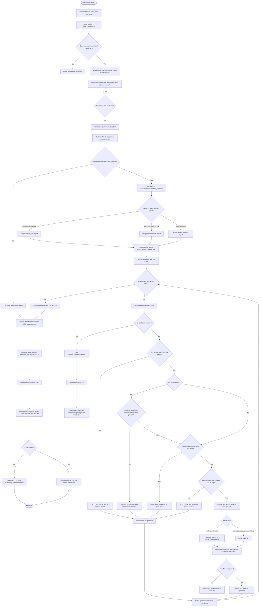

# Multi-Agent Voice Workflow Flowchart

## Parallel versus sequential execution

- A single turn is sequential: audio → transcript → agent assignment → model →
  optional tool loop → final response → TTS.
- One specialist handles a turn; tool follow-up stays with that specialist.
- Specialists are **not** run in parallel. `LlmToolCallExecutor.execute_tool_calls()` loops over
  tool calls one at a time. Separate voice sessions can run concurrently.

## Function and file index

| Function | File | What it does |
|---|---|---|
| `voice_socket(ws)` | `modules/realtime/voice_controller.py` | Accepts `/ws/voice`, checks Deepgram settings, connects STT and constructs `RealtimeVoiceSession`. |
| `RealtimeVoiceSession.pump_client()` | `modules/realtime/session.py` | Forwards browser audio to Deepgram; handles config and interrupt messages. |
| `RealtimeVoiceSession.pump_deepgram()` | `modules/realtime/session.py` | Processes Deepgram events/transcripts and starts turns. |
| `RealtimeVoiceSession.start_turn()` | `modules/realtime/session.py` | Takes buffered transcript and schedules a response. |
| `RealtimeVoiceSession.run(text)` | `modules/realtime/session.py` | Calls the workflow, streams response events, chunks speech, invokes TTS and updates history. |
| `ConversationWorkflow.stream(text, history)` | `modules/workflow/graph.py` | Runs guardrail and LangGraph; yields response text or control markers. |
| `RegexInjectionGuardrail.is_allowed(text)` | `modules/llm/guard_rail.py` | Allows or rejects user input before model processing. |
| `route_to_agent(messages)` | `modules/workflow/agents.py` | Selects `dental_care`, `appointments`, or `patient_records`. |
| `messages_for_agent(...)` | `modules/workflow/agents.py` | Creates specialist prompt with assigned task and permitted tools. |
| `ConversationWorkflow._respond(state)` | `modules/workflow/graph.py` | Calls the model using the selected specialist prompt and scoped tools. |
| `ConversationWorkflow._route_after_response(state)` | `modules/workflow/graph.py` | Sends tool requests to `_tools`; sends final replies to `_record_turn`. |
| `ConversationWorkflow._tools(state)` | `modules/workflow/graph.py` | Handles escalation and checks tool scope, booking confirmation, phone format, duplicates and limits. |
| `LlmToolCallExecutor.execute_tool_calls(response, messages)` | `modules/llm/tool_executor.py` | Runs approved calls sequentially and appends tool results. |
| `LlmToolCallExecutor._validate_and_execute_booking(...)` | `modules/llm/tool_executor.py` | Checks booking fields and explicit confirmation before booking. |
| `book_appointment(...)` / `create_appointment_booking_handler(...)` | `modules/tools/appointment.py` | Validates and delegates booking to the repository. |
| `find_patient_by_phone(...)`, `list_services(...)`, `list_providers(...)`, `find_available_slots(...)` | `modules/tools/portal_tools.py` | Retrieve patient and clinic appointment data. |
| `CustomerPortalHttpClient.request(...)` | `modules/portal/client.py` | Makes authenticated requests to the customer portal API. |
| `ConversationWorkflow._record_turn(state)` | `modules/workflow/graph.py` | Extracts final response text or returns the hangup marker. |
| `RealtimeVoiceSession._speak(text, elapsed)` | `modules/realtime/session.py` | Sends response text to TTS and streams generated audio. |
| `SentenceChunkSplitter.split(...)` | `modules/llm/chunking.py` | Splits response text into speech-ready chunks. |
