# Backend function guide

This guide maps the backend's main functions and classes to their callers. The
call paths below describe this project only; framework callbacks (FastAPI routes,
dependency injection, and websocket handlers) are invoked by FastAPI at runtime.

## Complete realtime voice-call flow

The diagram follows one `/ws/voice` connection from the browser handshake through
resource cleanup. Solid paths are normal processing; decision branches show the
main early-exit, interruption, and error paths.

### Lifeline sequence diagram

This view uses vertical participant lifelines like your example. The detailed
function flowchart below it expands the helper calls inside each participant.

```mermaid
sequenceDiagram
    autonumber
    participant Browser
    participant FastAPI
    participant Controller as voice_controller.py
    participant Session as VoiceSession
    participant DG as Deepgram realtime
    participant Turn as TurnManager
    participant LLM as LLMresponse
    participant TTS as TtsService
    participant History as InMemoryHistory

    Browser->>FastAPI: Connect to /ws/voice
    FastAPI->>Controller: voice_socket(ws)
    Controller->>Browser: ws.accept()
    Controller->>Controller: get_settings()
    Controller->>Controller: Check Deepgram API key
    alt API key missing
        Controller-->>Browser: Close with code 1011
    else API key configured
        Controller->>DG: DeepgramRealtimeConnector.connect()
        Note over Controller,DG: connect() builds URL with build_listen_url()
        alt Deepgram connection fails
            Controller-->>Browser: Close with code 1011
        else Connected
            Controller->>Session: VoiceSession(ws, dg, voice, settings)
            Note over Session: Build LLMresponse, TtsService, history,<br/>splitter, publisher, TranscriptBuffer, TurnManager,<br/>GreetingService, and _SpeakerAdapter
            Controller->>Controller: _run_session(ws, dg, session)
            Controller->>Browser: Send ready event (sample rates and voices)

            par Browser input pump
                loop Until browser disconnects
                    Browser->>Session: Send audio bytes or JSON message
                    alt Audio bytes
                        Session->>DG: dg.send(audio bytes)
                    else config message with allowed voice
                        Session->>Session: Update session and greeting voice
                    else interrupt message
                        Session->>Turn: cancel_turn() → TurnManager.cancel()
                        opt A response turn is active
                            Turn-->>Browser: Send interrupt event
                        end
                    else Browser disconnects
                        Session-->>Controller: pump_client() ends
                    end
                end
            and Deepgram event pump
                loop Until Deepgram stream ends
                    DG-->>Session: SpeechStarted, Results, UtteranceEnd, or Error
                    alt SpeechStarted and BARGE_IN enabled
                        Session->>Turn: cancel_turn() → TurnManager.cancel()
                    else Results event
                        Session->>Browser: Send transcript event
                        opt Final transcript segment with text
                            Session->>Session: TranscriptBuffer.add_final(text)
                        end
                        opt speech_final is true
                            Session->>Session: start_turn() → TranscriptBuffer.take()
                            opt Transcript buffer contains text
                                Session->>Turn: TurnManager.start(text)
                                Turn->>Turn: Cancel prior turn; create run(text) task
                                Turn->>Browser: Send user and answer_start events
                                Turn->>History: snapshot()
                                History-->>Turn: Conversation history
                                Turn->>LLM: stream(text, history)
                                LLM->>LLM: RegexInjectionGuardrail.is_allowed()
                                alt Rejected by guardrail
                                    LLM-->>Turn: Yield out-of-scope reply
                                else Allowed; model returns no tool call
                                    LLM->>LLM: llm_with_tools.ainvoke(messages)
                                    LLM->>LLM: _stream_plain() via llm.astream()
                                    LLM-->>Turn: Stream response text pieces
                                else Allowed; model requests a tool
                                    LLM->>LLM: ToolExecutor.execute()
                                    opt book_appointment requested
                                        LLM->>LLM: Check required booking fields
                                        alt Required fields missing
                                            LLM->>LLM: Append ToolMessage asking for missing details
                                        else Booking details present
                                            LLM->>LLM: book_appointment() handler and validator
                                            LLM->>LLM: LoggingAppointmentRepository.book()
                                            LLM->>LLM: Append booking result ToolMessage
                                        end
                                    end
                                    LLM->>LLM: Stream final response after tool result
                                    LLM-->>Turn: Stream response text pieces
                                end
                                loop For each response text piece
                                    Turn->>Browser: Send token event
                                    Turn->>Turn: SentenceChunkSplitter.split(buffer)
                                    opt Speakable text chunk is ready
                                        Turn->>TTS: _speak() → TtsService.speak(text, voice, callback)
                                        TTS->>TTS: Validate; ThreadedAsyncSpeaker streams generator chunks
                                        TTS->>DG: DeepgramAudioGenerator requests speech audio
                                        TTS-->>Browser: Send audio bytes via websocket callback
                                    end
                                end
                                opt Text remains after LLM stream ends
                                    Turn->>TTS: Speak final text buffer
                                    TTS-->>Browser: Send final audio bytes
                                end
                                Turn->>History: add_turn(user text, assistant answer)
                                Turn->>Browser: Send answer_end event
                            end
                        end
                    else UtteranceEnd event
                        Session->>Session: start_turn() → TranscriptBuffer.take()
                        opt Transcript buffer contains text
                            Session->>Turn: TurnManager.start(text)
                            Note over Turn,History: Follows the same assistant-turn sequence above
                        end
                    else Deepgram Error event
                        Session->>Session: Log Deepgram error; keep listening
                    end
                end
                DG-->>Controller: Deepgram pump ends or fails
            and Keepalive task
                loop While call is active
                    Session->>Session: asyncio.sleep(8)
                    Session->>DG: Send KeepAlive
                end
            and Greeting task, once per call
                Controller->>Session: send_greeting()
                Session->>Browser: Send answer_start and greeting token
                Session->>TTS: _SpeakerAdapter.speak() → TtsService.speak()
                TTS-->>Browser: Stream greeting audio bytes
                Session->>History: add_ai(greeting)
                Session->>Browser: Send answer_end event
            end

            Note over Controller,Session: _run_session waits for the first supervised pump/task to finish;<br/>the one-shot greeting is intentionally outside that race
            Controller->>Session: Cancel pending pump and keepalive tasks
            Controller->>Turn: Cancel active turn if present
            Controller->>DG: Send CloseStream; close Deepgram socket
            Controller->>Browser: Close websocket
            Controller->>Controller: Log connection closed
        end
    end
```

```mermaid
flowchart TD
    Browser([Browser opens /ws/voice]) --> FastAPI[FastAPI routes websocket]
    FastAPI --> Socket[voice_socket ws]
    Socket --> Accept[ws.accept]
    Accept --> Settings[get_settings]
    Settings --> Key{Deepgram API key configured?}
    Key -- No --> CloseConfig[ws.close code 1011: key missing]
    Key -- Yes --> Connector[DeepgramRealtimeConnector]
    Connector --> Connect[connect]
    Connect --> URL[build_listen_url input sample rate]
    URL --> DeepgramConnect{Deepgram websocket connects?}
    DeepgramConnect -- No --> LogConnect[Log connection failure]
    LogConnect --> CloseConnect[ws.close code 1011: STT connection failed]
    DeepgramConnect -- Yes --> Session[VoiceSession ws, dg, voice, settings]

    subgraph Construction[Per-call service construction in VoiceSession.__init__]
        Session --> Defaults{LLM or TTS injected?}
        Defaults -- No LLM --> LLMConstruct[LLMresponse]
        LLMConstruct --> GuardConstruct[RegexInjectionGuardrail]
        LLMConstruct --> ToolConstruct[ToolExecutor]
        ToolConstruct --> ToolRegistry[Load TOOL_REGISTRY]
        Defaults -- No TTS --> TTSConstruct[TtsService]
        TTSConstruct --> Validator[AllowedVoiceValidator]
        TTSConstruct --> Generator[DeepgramAudioGenerator]
        TTSConstruct --> Speaker[ThreadedAsyncSpeaker]
        Defaults --> History[InMemoryHistory configured window]
        Defaults --> Splitter[SentenceChunkSplitter]
        Defaults --> Publisher[WsPublisher]
        Defaults --> Buffer[TranscriptBuffer]
        Defaults --> TurnManager[TurnManager with publisher, LLM, TTS, history, splitter]
        Defaults --> GreetingConstruct[GreetingService with _SpeakerAdapter]
    end

    Session --> RunSession[_run_session ws, dg, session]
    RunSession --> Ready[Send ready event: sample rates and voices]
    Ready --> ClientTask[Start pump_client task]
    Ready --> DGTask[Start pump_deepgram task]
    Ready --> KeepaliveTask[Start keepalive task]
    Ready --> GreetingTask[Start send_greeting task separately]

    subgraph ClientPump[Browser-to-Deepgram path: pump_client]
        ClientTask --> Receive[ws.receive]
        Receive --> ClientKind{Disconnect, audio bytes, or text?}
        ClientKind -- Disconnect --> ClientDisconnect[Raise WebSocketDisconnect]
        ClientKind -- Audio bytes --> SendAudio[dg.send audio bytes]
        SendAudio --> Receive
        ClientKind -- Empty text --> Receive
        ClientKind -- JSON text --> ParseJSON[json.loads; ignore invalid JSON]
        ParseJSON --> ClientEvent{Message type?}
        ClientEvent -- config --> VoiceAllowed{Voice is in VOICES?}
        VoiceAllowed -- Yes --> SetVoice[Update session and greeting voice]
        VoiceAllowed -- No --> Receive
        SetVoice --> Receive
        ClientEvent -- interrupt --> CancelFromClient[VoiceSession.cancel_turn]
        CancelFromClient --> CancelManager1[TurnManager.cancel]
        CancelManager1 --> Receive
        ClientEvent -- Other --> Receive
    end

    subgraph DeepgramPump[Deepgram-to-assistant path: pump_deepgram]
        DGTask --> IterateDG[async for raw event in dg]
        IterateDG --> DecodeEvent[json.loads raw event]
        DecodeEvent --> DGKind{Deepgram event type?}
        DGKind -- SpeechStarted --> BargeIn{barge_in enabled?}
        BargeIn -- Yes --> CancelFromBarge[VoiceSession.cancel_turn]
        CancelFromBarge --> CancelManager2[TurnManager.cancel]
        CancelManager2 --> IterateDG
        BargeIn -- No --> IterateDG
        DGKind -- Results --> Extract[Read transcript, is_final, speech_final]
        Extract --> HasTranscript{Transcript is non-empty?}
        HasTranscript -- Yes --> SendTranscript[WsPublisher.send_json transcript event]
        HasTranscript -- No --> FinalCheck
        SendTranscript --> FinalCheck{Final transcript segment?}
        FinalCheck -- Yes --> AddTranscript[TranscriptBuffer.add_final]
        FinalCheck -- No --> SpeechFinal
        AddTranscript --> SpeechFinal{speech_final?}
        SpeechFinal -- Yes --> StartTurn1[VoiceSession.start_turn]
        SpeechFinal -- No --> IterateDG
        StartTurn1 --> TakeTranscript[TranscriptBuffer.take and clear buffer]
        DGKind -- UtteranceEnd --> StartTurn2[VoiceSession.start_turn]
        StartTurn2 --> TakeTranscript
        TakeTranscript --> HasText{Accumulated text non-empty?}
        HasText -- No --> IterateDG
        HasText -- Yes --> ManagerStart[TurnManager.start text]
        ManagerStart --> CancelOld[TurnManager.cancel previous turn if running]
        CancelOld --> CreateTurn[Create asynchronous TurnManager.run task]
        CreateTurn --> IterateDG
        DGKind -- Error --> LogDG[Log Deepgram error]
        LogDG --> IterateDG
        DGKind -- Other --> IterateDG
    end

    subgraph AssistantTurn[Assistant turn: TurnManager.run]
        CreateTurn --> TurnStart[Start timer; send user and answer_start events]
        TurnStart --> HistorySnapshot[InMemoryHistory.snapshot]
        HistorySnapshot --> LLMStream[LLMresponse.stream text and history]
        LLMStream --> Guard[RegexInjectionGuardrail.is_allowed]
        Guard --> Allowed{Input allowed?}
        Allowed -- No --> OutOfScope[Yield OUT_OF_SCOPE_REPLY]
        Allowed -- Yes --> ModelTools[llm_with_tools.ainvoke messages]
        ModelTools --> ModelResult{Provider call result?}
        ModelResult -- Tool validation error --> Fallback[_stream_plain using llm.astream]
        ModelResult -- Other exception --> LLMError[Log LLM failure and propagate]
        ModelResult -- No tool calls --> Plain[_stream_plain using llm.astream]
        ModelResult -- Tool calls --> ToolExec[ToolExecutor.execute]
        ToolExec --> ToolKind{Tool name?}
        ToolKind -- book_appointment --> BookingArgs[Check required booking fields]
        BookingArgs --> BookingFields{Any required fields missing?}
        BookingFields -- Yes --> MissingMessage[Append ToolMessage asking for missing details]
        BookingFields -- No --> BookingTool[Invoke registered book_appointment tool]
        BookingTool --> BookingHandler[make_booking_handler handler]
        BookingHandler --> ValidatorCall[StrictAppointmentValidator.missing_fields]
        ValidatorCall --> ValidBooking{Fields valid?}
        ValidBooking -- No --> MissingMessage
        ValidBooking -- Yes --> Repository[LoggingAppointmentRepository.book]
        Repository --> BookingResult[Append booking result ToolMessage]
        MissingMessage --> FinalModel
        BookingResult --> FinalModel[Stream final model response after tool result]
        ToolKind -- Other registered tool --> GenericTool[Invoke tool.ainvoke]
        GenericTool --> GenericResult[Append result or technical-failure ToolMessage]
        GenericResult --> FinalModel
        ToolKind -- Unknown tool --> UnknownTool[Append unknown-tool ToolMessage]
        UnknownTool --> FinalModel
        OutOfScope --> TextPieces
        Fallback --> TextPieces
        Plain --> TextPieces
        FinalModel --> TextPieces[Yield response text pieces]
        TextPieces --> TokenEvent[Send token event; append piece to buffer]
        TokenEvent --> Split[SentenceChunkSplitter.split buffer]
        Split --> SpeakChunk{Speakable chunk produced?}
        SpeakChunk -- No --> MorePieces{More LLM pieces?}
        SpeakChunk -- Yes --> Speak[TurnManager._speak chunk]
        Speak --> TTSSpeak[TtsService.speak text, voice, callback]
        TTSSpeak --> ValidateTTS[TtsService._validate text and voice]
        ValidateTTS --> AsyncSpeaker[ThreadedAsyncSpeaker.speak]
        AsyncSpeaker --> Producer[Worker thread iterates TtsService.stream]
        Producer --> ValidateStream[TtsService._validate]
        ValidateStream --> IterateAudio[DeepgramAudioGenerator.iter_chunks]
        IterateAudio --> RawProbe{Raw PCM request supported?}
        RawProbe -- Unknown --> RawGenerate[DeepgramAudioGenerator._generate_raw raw PCM]
        RawGenerate --> RawAccepted{Provider accepts raw PCM?}
        RawAccepted -- Yes --> QueueAudio[Queue audio chunks to event loop]
        RawAccepted -- No --> WAVFallback[Log fallback; generate WAV chunks]
        RawProbe -- Supported --> QueueAudio
        RawProbe -- WAV fallback set --> WAVFallback
        WAVFallback --> StripHeader[ThreadedAsyncSpeaker strips WAV header when present]
        QueueAudio --> Callback[AsyncSpeaker calls send_bytes callback]
        StripHeader --> Callback
        Callback --> AudioEvent[WsPublisher.send_bytes to browser]
        AudioEvent --> MorePieces
        MorePieces -- Yes --> TextPieces
        MorePieces -- No --> RemainingBuffer{Text buffer has remainder?}
        RemainingBuffer -- Yes --> SpeakRemainder[Speak final remainder via _speak and TTS path]
        RemainingBuffer -- No --> SaveTurn
        SpeakRemainder --> SaveTurn[InMemoryHistory.add_turn]
        SaveTurn --> AnswerEnd[Send answer_end event]
        LLMError --> TurnFailure[TurnManager.run logs failure]
        TurnFailure --> ErrorEvent[Send error and answer_end events]
        Speak --> Cancelled{Turn cancelled?}
        Cancelled -- Yes --> LogCancelled[Log cancellation and re-raise]
        LogCancelled --> TurnStops[Turn task stops]
    end

    subgraph Greeting[Greeting path: send_greeting task]
        GreetingTask --> SendGreeting[VoiceSession.send_greeting; sync latest voice]
        SendGreeting --> GreetingService[GreetingService.send]
        GreetingService --> GreetingStart[Send answer_start and greeting token]
        GreetingStart --> GreetingSpeak[_SpeakerAdapter.speak]
        GreetingSpeak --> GreetingTTS[TtsService.speak with selected voice]
        GreetingTTS --> GreetingAudio[WsPublisher sends greeting audio bytes]
        GreetingAudio --> AddGreeting[InMemoryHistory.add_ai greeting]
        AddGreeting --> GreetingEnd[Send answer_end event]
        GreetingService -. On error: log and attempt answer_end .-> GreetingEnd
    end

    subgraph Keepalive[Deepgram keepalive path]
        KeepaliveTask --> Wait[asyncio.sleep 8 seconds]
        Wait --> KeepaliveSend[dg.send KeepAlive]
        KeepaliveSend --> Wait
    end

    ClientDisconnect --> SessionEnd
    IterateDG --> DGEnd{Deepgram iterator ends or raises?}
    DGEnd --> SessionEnd
    KeepaliveSend -. Send failure .-> SessionEnd
    SessionEnd[_run_session FIRST_COMPLETED returns] --> CancelPending[Cancel other pump and keepalive tasks]
    CancelPending --> ActiveTurn{Active TurnManager task?}
    ActiveTurn -- Yes --> CancelTurn[Cancel active turn]
    ActiveTurn -- No --> CloseDeepgram
    CancelTurn --> CloseDeepgram[Try sending Deepgram CloseStream]
    CloseDeepgram --> CloseDG[Close Deepgram connection]
    CloseDG --> CloseBrowser[Try closing browser websocket]
    CloseBrowser --> LogClosed[Log websocket connection closed]
```



### Call lifecycle notes

- The greeting runs concurrently with the client pump, Deepgram pump, and
  keepalive. It is deliberately not included in the `FIRST_COMPLETED` task race:
  finishing the greeting alone must not end the call.
- `SpeechStarted` only interrupts an active assistant response when the
  `BARGE_IN` setting is enabled. A browser `interrupt` message always requests
  cancellation.
- `speech_final` and `UtteranceEnd` both try to start a turn. If the transcript
  buffer is empty, `start_turn()` returns without creating a turn.
- `TurnManager.start()` cancels an existing turn before scheduling its
  replacement, so a new recognized utterance supersedes the previous response.
- A turn error is reported to the browser and does not itself close the call.
  The call cleanup begins when a supervised client, Deepgram, or keepalive task
  finishes or fails.
- The REST routes (`speech_to_text()` and `generate_audio()`) and scripts under
  `scripts/` are separate entry points, not part of the `/ws/voice` lifecycle.

## Application entry and request routes

- `main.py`
  - `root()` is the `GET /` handler; FastAPI serves `static/index.html`.
  - `start()` launches Uvicorn and is called by the `if __name__ == "__main__"`
    entry point. The module creates the FastAPI app and registers the STT, TTS,
    and realtime routers.
- `modules/stt/stt_controller.py`
  - `speech_to_text()` is called by FastAPI for `POST /stt/audio`. It reads the
    upload, calls `FileTranscriber.transcribe()`, and, when there is a transcript,
    calls `LlmAssistant.llm_response()` to produce an answer.
- `modules/tts/tts_controller.py`
  - `generate_audio()` is called by FastAPI for `GET /tts/audio`. It gets a
    synthesizer through `get_tts()`, calls `text_to_speech()`, and returns WAV
    bytes.
- `modules/realtime/voice_controller.py`
  - `voice_socket()` is the FastAPI `/ws/voice` websocket handler. It validates
    settings, connects to Deepgram, creates `VoiceSession`, then calls
    `_run_session()`.
  - `_run_session()` sends the client configuration and supervises the session's
    client-audio, Deepgram-audio, and keepalive tasks; it then closes resources.

## Shared settings and dependency wiring

- `modules/common/settings.py`
  - `_load_env_once()` loads environment files at import time.
  - `_as_bool()` converts environment strings to booleans; `Settings` reads the
    application's configuration; `get_settings()` creates and caches one
    settings object. Controllers and services use `get_settings()` directly.
- `modules/common/dependencies.py`
  - `get_tts()` and `get_llm()` return cached service instances to REST handlers
    and other consumers using FastAPI `Depends`.
  - `get_file_transcriber()` constructs the implementation injected into the
    STT REST route.
- `modules/common/protocols.py` defines the abstract interfaces implemented by
  services and accepted by controllers. These classes are contracts, not runtime
  entry points; dependency providers supply their concrete implementations.
- `modules/common/__init__.py` is the package marker; it has no runtime function.

## Speech recognition (STT)

- `modules/stt/stt_service.py`
  - `_default_input_rate()` gets the configured input sample rate.
  - `DeepgramFileTranscriber.transcribe()` is called by the `POST /stt/audio`
    handler to send uploaded audio to Deepgram and return recognized text.
- `modules/stt/connector.py`
  - `build_listen_url()` builds the Deepgram streaming URL and is used by
    `DeepgramRealtimeConnector.connect()`.
  - `DeepgramRealtimeConnector.connect()` establishes the streaming connection
    used by `voice_socket()`.
  - The websocket route uses `DeepgramRealtimeConnector` directly.

## Realtime conversation

- `modules/realtime/session.py`
  - `VoiceSession` coordinates a single websocket call. `_run_session()` starts
    its `pump_client()`, `pump_deepgram()`, `keepalive()`, and `send_greeting()`
    coroutines. The pumps pass audio/transcripts through the turn manager and
    publish events to the client.
  - `TurnManager` coordinates each recognized user turn: it applies the
    guardrail, invokes the LLM, splits response text, and sends speech through
    TTS. `VoiceSession` creates and uses it.
  - `TranscriptBuffer` accumulates partial/final transcript text for the session.
  - `WsPublisher` sends structured events to the websocket and is used by
    `VoiceSession`/`TurnManager`.
  - `_SpeakerAdapter` adapts the configured speaker interface for use by the
    session's audio playback flow.
- `modules/realtime/greeting.py`: `GreetingService` sends the initial configured
  greeting through the conversation's speech/audio output path; `VoiceSession`
  starts it via `send_greeting()`.
- `modules/realtime/history.py`: `InMemoryHistory` stores bounded conversation
  turns; the realtime turn manager uses it to supply prior context to the LLM.

## Language model and tools

- `modules/llm/llm_service.py`
  - `_as_text()` converts provider content blocks into text and is used when
    yielding LLM response chunks.
  - `_stream_plain()` streams a normal response and is called by
    `LLMresponse.stream()` when there is no tool call or a tool-validation
    failure.
  - `LLMresponse._messages()` combines the system prompt, history, and user
    input. `LLMresponse.stream()` is called by realtime turns and
    `llm_response()`; `llm_response()` collects that stream into a string for
    REST STT's optional answer.
- `modules/llm/guard_rail.py`: `RegexInjectionGuardrail` checks requests before
  they reach the model. `LLMresponse.stream()` calls its `is_allowed()` method;
  `RegexInjectionGuardrail.is_allowed()` is called by `LLMresponse.stream()`.
- `modules/llm/tool_executor.py`: `ToolExecutor` exposes registered LLM tools
  and runs requested calls. `LLMresponse` binds its tools at construction and
  calls `execute()` after the model returns tool calls.
- `modules/llm/errors.py`: `is_tool_validation_error()` classifies provider
  errors; `LLMresponse.stream()` uses it to decide whether to fall back to a
  plain response.
- `modules/llm/chunking.py`: `SentenceChunkSplitter` splits generated text into
  speakable pieces. The realtime turn pipeline uses it while streaming LLM
  output to TTS.
- `modules/tools/appointment.py`: `book_appointment()` is registered as an LLM
  tool and is invoked by `ToolExecutor` when the model requests a booking.
  `make_booking_handler()` wires the repository and validator into that tool;
  `_missing_message()` formats missing-field feedback.
- `modules/tools/repository.py`: `LoggingAppointmentRepository` and
  `StrictAppointmentValidator` implement the booking contracts used by the
  appointment tool. `get_default_repository()` and `get_default_validator()`
  supply their default implementations to the handler.

## Text-to-speech (TTS)

- `modules/tts/tts_service.py`: `TtsService` composes audio generation,
  chunking, and streaming/speaker support. REST `generate_audio()` calls its
  full-text synthesis method; realtime turns call its streaming methods.
- `modules/tts/generator.py`: `DeepgramAudioGenerator` calls the speech provider
  to generate audio; `TtsService` uses it for speech output.
- `modules/tts/speaker.py`: `ThreadedAsyncSpeaker` adapts blocking audio playback
  to asynchronous use; the TTS/realtime audio path uses this adapter.
- `modules/tts/voices.py`: `AllowedVoiceValidator` validates requested voice
  identifiers for synthesis. The realtime controller reads the configured
  default voice from `Settings`.

## Developer scripts

- `scripts/check_llm.py`: `main()` is the standalone LLM connectivity check.
- `scripts/check_tts.py`: `main()` is the standalone TTS connectivity check.
- `scripts/list_models.py`: `main()` queries and prints available models.
  Each script calls its own `main()` when executed as a script; application
  routes do not call these utilities.

## Backend support files

- `Dockerfile` defines the container build and startup command; it contains no
  application functions.
- `pyproject.toml` and `requirements.txt` declare package/runtime dependencies
  and project configuration; they are consumed by tooling and installation,
  not called by application code.
- `uv.lock` pins resolved dependencies for reproducible installs.
- `src/backend/__init__.py` marks the optional `backend` package namespace;
  the runnable application entry point is `main.py`.
- `static/index.html` is the document returned by `root()`.
