# Backend function guide

This guide maps the backend's main functions and classes to their callers. The
call paths below describe this project only; framework callbacks (FastAPI routes,
dependency injection, and websocket handlers) are invoked by FastAPI at runtime.

## Complete realtime voice-call flow

The diagram follows one `/ws/voice` connection from the browser handshake through
resource cleanup. Solid paths are normal processing; decision branches show the
main early-exit, interruption, and error paths.

### Lifeline sequence diagram

This view uses vertical participant lifelines like your example. The detailed
function flowchart below it expands the helper calls inside each participant.

```mermaid
sequenceDiagram
    autonumber
    participant Browser
    participant FastAPI
    participant Controller as voice_controller.py
    participant Session as RealtimeVoiceSession
    participant DG as Deepgram realtime
    participant Turn as AssistantTurnManager
    participant LLM as GroqLlmAssistant
    participant TTS as TextToSpeechService
    participant History as InMemoryConversationHistory

    Browser->>FastAPI: Connect to /ws/voice
    FastAPI->>Controller: voice_socket(ws)
    Controller->>Browser: ws.accept()
    Controller->>Controller: get_settings()
    Controller->>Controller: Check Deepgram API key
    alt API key missing
        Controller-->>Browser: Close with code 1011
    else API key configured
        Controller->>DG: DeepgramRealtimeConnector.connect()
        Note over Controller,DG: connect() builds URL with build_listen_build_portal_url()
        alt Deepgram connection fails
            Controller-->>Browser: Close with code 1011
        else Connected
            Controller->>Session: RealtimeVoiceSession(ws, dg, voice, settings)
            Note over Session: Build GroqLlmAssistant, TextToSpeechService, history,<br/>splitter, publisher, PendingTranscriptBuffer, AssistantTurnManager,<br/>GreetingService, and _SpeakerAdapter
            Controller->>Controller: _run_session(ws, dg, session)
            Controller->>Browser: Send ready event (sample rates and voices)

            par Browser input pump
                loop Until browser disconnects
                    Browser->>Session: Send audio bytes or JSON message
                    alt Audio bytes
                        Session->>DG: dg.send(audio bytes)
                    else config message with allowed voice
                        Session->>Session: Update session and greeting voice
                    else interrupt message
                        Session->>Turn: cancel_turn() → AssistantTurnManager.cancel()
                        opt A response turn is active
                            Turn-->>Browser: Send interrupt event
                        end
                    else Browser disconnects
                        Session-->>Controller: pump_client() ends
                    end
                end
            and Deepgram event pump
                loop Until Deepgram stream ends
                    DG-->>Session: SpeechStarted, Results, UtteranceEnd, or Error
                    alt SpeechStarted and BARGE_IN enabled
                        Session->>Turn: cancel_turn() → AssistantTurnManager.cancel()
                    else Results event
                        Session->>Browser: Send transcript event
                        opt Final transcript segment with text
                            Session->>Session: PendingTranscriptBuffer.add_final_transcript(text)
                        end
                        opt speech_final is true
                            Session->>Session: start_turn() → PendingTranscriptBuffer.take_pending_transcript()
                            opt Transcript buffer contains text
                                Session->>Turn: AssistantTurnManager.start(text)
                                Turn->>Turn: Cancel prior turn; create run(text) task
                                Turn->>Browser: Send user and answer_start events
                                Turn->>History: snapshot()
                                History-->>Turn: Conversation history
                                Turn->>LLM: stream(text, history)
                                LLM->>LLM: RegexInjectionGuardrail.is_allowed()
                                alt Rejected by guardrail
                                    LLM-->>Turn: Yield out-of-scope reply
                                else Allowed; model returns no tool call
                                    LLM->>LLM: llm_with_tools.ainvoke(messages)
                                    LLM->>LLM: _stream_plain_llm_response() via llm.astream()
                                    LLM-->>Turn: Stream response text pieces
                                else Allowed; model requests a tool
                                    LLM->>LLM: LlmToolCallExecutor.execute_tool_calls()
                                    opt book_appointment requested
                                        LLM->>LLM: Check required booking fields
                                        alt Required fields missing
                                            LLM->>LLM: Append ToolMessage asking for missing details
                                        else Booking details present
                                            LLM->>LLM: book_appointment() handler and validator
                                            LLM->>LLM: FallbackLoggingAppointmentRepository.book()
                                            LLM->>LLM: Append booking result ToolMessage
                                        end
                                    end
                                    LLM->>LLM: Stream final response after tool result
                                    LLM-->>Turn: Stream response text pieces
                                end
                                loop For each response text piece
                                    Turn->>Browser: Send token event
                                    Turn->>Turn: SentenceChunkSplitter.split(buffer)
                                    opt Speakable text chunk is ready
                                        Turn->>TTS: _speak() → TextToSpeechService.speak(text, voice, callback)
                                        TTS->>TTS: Validate; ThreadedTextToSpeechSpeaker streams generator chunks
                                        TTS->>DG: DeepgramAudioGenerator requests speech audio
                                        TTS-->>Browser: Send audio bytes via websocket callback
                                    end
                                end
                                opt Text remains after LLM stream ends
                                    Turn->>TTS: Speak final text buffer
                                    TTS-->>Browser: Send final audio bytes
                                end
                                Turn->>History: add_turn(user text, assistant answer)
                                Turn->>Browser: Send answer_end event
                            end
                        end
                    else UtteranceEnd event
                        Session->>Session: start_turn() → PendingTranscriptBuffer.take_pending_transcript()
                        opt Transcript buffer contains text
                            Session->>Turn: AssistantTurnManager.start(text)
                            Note over Turn,History: Follows the same assistant-turn sequence above
                        end
                    else Deepgram Error event
                        Session->>Session: Log Deepgram error; keep listening
                    end
                end
                DG-->>Controller: Deepgram pump ends or fails
            and Keepalive task
                loop While call is active
                    Session->>Session: asyncio.sleep(8)
                    Session->>DG: Send KeepAlive
                end
            and Greeting task, once per call
                Controller->>Session: send_greeting()
                Session->>Browser: Send answer_start and greeting token
                Session->>TTS: _SpeakerAdapter.speak() → TextToSpeechService.speak()
                TTS-->>Browser: Stream greeting audio bytes
                Session->>History: add_ai(greeting)
                Session->>Browser: Send answer_end event
            end

            Note over Controller,Session: _run_session waits for the first supervised pump/task to finish;<br/>the one-shot greeting is intentionally outside that race
            Controller->>Session: Cancel pending pump and keepalive tasks
            Controller->>Turn: Cancel active turn if present
            Controller->>DG: Send CloseStream; close Deepgram socket
            Controller->>Browser: Close websocket
            Controller->>Controller: Log connection closed
        end
    end
```



```mermaid
flowchart TD
    Browser([Browser opens /ws/voice]) --> FastAPI[FastAPI routes websocket]
    FastAPI --> Socket[voice_socket ws]
    Socket --> Accept[ws.accept]
    Accept --> Settings[get_settings]
    Settings --> Key{Deepgram API key configured?}
    Key -- No --> CloseConfig[ws.close code 1011: key missing]
    Key -- Yes --> Connector[DeepgramRealtimeConnector]
    Connector --> Connect[connect]
    Connect --> URL[build_listen_build_portal_url input sample rate]
    URL --> DeepgramConnect{Deepgram websocket connects?}
    DeepgramConnect -- No --> LogConnect[Log connection failure]
    LogConnect --> CloseConnect[ws.close code 1011: STT connection failed]
    DeepgramConnect -- Yes --> Session[RealtimeVoiceSession ws, dg, voice, settings]

    subgraph Construction[Per-call service construction in RealtimeVoiceSession.__init__]
        Session --> Defaults{LLM or TTS injected?}
        Defaults -- No LLM --> LLMConstruct[GroqLlmAssistant]
        LLMConstruct --> GuardConstruct[RegexInjectionGuardrail]
        LLMConstruct --> ToolConstruct[LlmToolCallExecutor]
        ToolConstruct --> ToolRegistry[Load TOOL_REGISTRY]
        Defaults -- No TTS --> TTSConstruct[TextToSpeechService]
        TTSConstruct --> Validator[AllowedVoiceValidator]
        TTSConstruct --> Generator[DeepgramAudioGenerator]
        TTSConstruct --> Speaker[ThreadedTextToSpeechSpeaker]
        Defaults --> History[InMemoryConversationHistory configured window]
        Defaults --> Splitter[SentenceChunkSplitter]
        Defaults --> Publisher[WebSocketMessagePublisher]
        Defaults --> Buffer[PendingTranscriptBuffer]
        Defaults --> AssistantTurnManager[AssistantTurnManager with publisher, LLM, TTS, history, splitter]
        Defaults --> GreetingConstruct[GreetingService with _SpeakerAdapter]
    end

    Session --> RunSession[_run_session ws, dg, session]
    RunSession --> Ready[Send ready event: sample rates and voices]
    Ready --> ClientTask[Start pump_client task]
    Ready --> DGTask[Start pump_deepgram task]
    Ready --> KeepaliveTask[Start keepalive task]
    Ready --> GreetingTask[Start send_greeting task separately]

    subgraph ClientPump[Browser-to-Deepgram path: pump_client]
        ClientTask --> Receive[ws.receive]
        Receive --> ClientKind{Disconnect, audio bytes, or text?}
        ClientKind -- Disconnect --> ClientDisconnect[Raise WebSocketDisconnect]
        ClientKind -- Audio bytes --> SendAudio[dg.send audio bytes]
        SendAudio --> Receive
        ClientKind -- Empty text --> Receive
        ClientKind -- JSON text --> ParseJSON[json.loads; ignore invalid JSON]
        ParseJSON --> ClientEvent{Message type?}
        ClientEvent -- config --> VoiceAllowed{Voice is in VOICES?}
        VoiceAllowed -- Yes --> SetVoice[Update session and greeting voice]
        VoiceAllowed -- No --> Receive
        SetVoice --> Receive
        ClientEvent -- interrupt --> CancelFromClient[RealtimeVoiceSession.cancel_turn]
        CancelFromClient --> CancelManager1[AssistantTurnManager.cancel]
        CancelManager1 --> Receive
        ClientEvent -- Other --> Receive
    end

    subgraph DeepgramPump[Deepgram-to-assistant path: pump_deepgram]
        DGTask --> IterateDG[async for raw event in dg]
        IterateDG --> DecodeEvent[json.loads raw event]
        DecodeEvent --> DGKind{Deepgram event type?}
        DGKind -- SpeechStarted --> BargeIn{barge_in enabled?}
        BargeIn -- Yes --> CancelFromBarge[RealtimeVoiceSession.cancel_turn]
        CancelFromBarge --> CancelManager2[AssistantTurnManager.cancel]
        CancelManager2 --> IterateDG
        BargeIn -- No --> IterateDG
        DGKind -- Results --> Extract[Read transcript, is_final, speech_final]
        Extract --> HasTranscript{Transcript is non-empty?}
        HasTranscript -- Yes --> SendTranscript[WebSocketMessagePublisher.send_json transcript event]
        HasTranscript -- No --> FinalCheck
        SendTranscript --> FinalCheck{Final transcript segment?}
        FinalCheck -- Yes --> AddTranscript[PendingTranscriptBuffer.add_final_transcript]
        FinalCheck -- No --> SpeechFinal
        AddTranscript --> SpeechFinal{speech_final?}
        SpeechFinal -- Yes --> StartTurn1[RealtimeVoiceSession.start_turn]
        SpeechFinal -- No --> IterateDG
        StartTurn1 --> TakeTranscript[PendingTranscriptBuffer.take and clear buffer]
        DGKind -- UtteranceEnd --> StartTurn2[RealtimeVoiceSession.start_turn]
        StartTurn2 --> TakeTranscript
        TakeTranscript --> HasText{Accumulated text non-empty?}
        HasText -- No --> IterateDG
        HasText -- Yes --> ManagerStart[AssistantTurnManager.start text]
        ManagerStart --> CancelOld[AssistantTurnManager.cancel previous turn if running]
        CancelOld --> CreateTurn[Create asynchronous AssistantTurnManager.run task]
        CreateTurn --> IterateDG
        DGKind -- Error --> LogDG[Log Deepgram error]
        LogDG --> IterateDG
        DGKind -- Other --> IterateDG
    end

    subgraph AssistantTurn[Assistant turn: AssistantTurnManager.run]
        CreateTurn --> TurnStart[Start timer; send user and answer_start events]
        TurnStart --> HistorySnapshot[InMemoryConversationHistory.snapshot]
        HistorySnapshot --> LLMStream[GroqLlmAssistant.stream text and history]
        LLMStream --> Guard[RegexInjectionGuardrail.is_allowed]
        Guard --> Allowed{Input allowed?}
        Allowed -- No --> OutOfScope[Yield OUT_OF_SCOPE_REPLY]
        Allowed -- Yes --> ModelTools[llm_with_tools.ainvoke messages]
        ModelTools --> ModelResult{Provider call result?}
        ModelResult -- Tool validation error --> Fallback[_stream_plain_llm_response using llm.astream]
        ModelResult -- Other exception --> LLMError[Log LLM failure and propagate]
        ModelResult -- No tool calls --> Plain[_stream_plain_llm_response using llm.astream]
        ModelResult -- Tool calls --> ToolExec[LlmToolCallExecutor.execute]
        ToolExec --> ToolKind{Tool name?}
        ToolKind -- book_appointment --> BookingArgs[Check required booking fields]
        BookingArgs --> BookingFields{Any required fields missing?}
        BookingFields -- Yes --> MissingMessage[Append ToolMessage asking for missing details]
        BookingFields -- No --> BookingTool[Invoke registered book_appointment tool]
        BookingTool --> BookingHandler[create_appointment_booking_handler handler]
        BookingHandler --> ValidatorCall[RequiredAppointmentFieldsValidator.missing_fields]
        ValidatorCall --> ValidBooking{Fields valid?}
        ValidBooking -- No --> MissingMessage
        ValidBooking -- Yes --> Repository[FallbackLoggingAppointmentRepository.book]
        Repository --> BookingResult[Append booking result ToolMessage]
        MissingMessage --> FinalModel
        BookingResult --> FinalModel[Stream final model response after tool result]
        ToolKind -- Other registered tool --> GenericTool[Invoke tool.ainvoke]
        GenericTool --> GenericResult[Append result or technical-failure ToolMessage]
        GenericResult --> FinalModel
        ToolKind -- Unknown tool --> UnknownTool[Append unknown-tool ToolMessage]
        UnknownTool --> FinalModel
        OutOfScope --> TextPieces
        Fallback --> TextPieces
        Plain --> TextPieces
        FinalModel --> TextPieces[Yield response text pieces]
        TextPieces --> TokenEvent[Send token event; append piece to buffer]
        TokenEvent --> Split[SentenceChunkSplitter.split buffer]
        Split --> SpeakChunk{Speakable chunk produced?}
        SpeakChunk -- No --> MorePieces{More LLM pieces?}
        SpeakChunk -- Yes --> Speak[AssistantTurnManager._speak chunk]
        Speak --> TTSSpeak[TextToSpeechService.speak text, voice, callback]
        TTSSpeak --> ValidateTTS[TextToSpeechService._validate_text_and_voice_for_synthesis text and voice]
        ValidateTTS --> AsyncSpeaker[ThreadedTextToSpeechSpeaker.speak]
        AsyncSpeaker --> Producer[Worker thread iterates DeepgramAudioGenerator.generate_audio_chunks]
        Producer --> IterateAudio[Yield PCM audio chunks]
        IterateAudio --> RawProbe{Raw PCM request supported?}
        RawProbe -- Unknown --> RawGenerate[DeepgramAudioGenerator._request_audio_from_deepgram raw PCM]
        RawGenerate --> RawAccepted{Provider accepts raw PCM?}
        RawAccepted -- Yes --> QueueAudio[Queue audio chunks to event loop]
        RawAccepted -- No --> WAVFallback[Log fallback; generate WAV chunks]
        RawProbe -- Supported --> QueueAudio
        RawProbe -- WAV fallback set --> WAVFallback
        WAVFallback --> StripHeader[ThreadedTextToSpeechSpeaker strips WAV header when present]
        QueueAudio --> Callback[AsyncSpeaker calls send_bytes callback]
        StripHeader --> Callback
        Callback --> AudioEvent[WebSocketMessagePublisher.send_bytes to browser]
        AudioEvent --> MorePieces
        MorePieces -- Yes --> TextPieces
        MorePieces -- No --> RemainingBuffer{Text buffer has remainder?}
        RemainingBuffer -- Yes --> SpeakRemainder[Speak final remainder via _speak and TTS path]
        RemainingBuffer -- No --> SaveTurn
        SpeakRemainder --> SaveTurn[InMemoryConversationHistory.add_turn]
        SaveTurn --> AnswerEnd[Send answer_end event]
        LLMError --> TurnFailure[AssistantTurnManager.run logs failure]
        TurnFailure --> ErrorEvent[Send error and answer_end events]
        Speak --> Cancelled{Turn cancelled?}
        Cancelled -- Yes --> LogCancelled[Log cancellation and re-raise]
        LogCancelled --> TurnStops[Turn task stops]
    end

    subgraph Greeting[Greeting path: send_greeting task]
        GreetingTask --> SendGreeting[RealtimeVoiceSession.send_greeting; sync latest voice]
        SendGreeting --> GreetingService[GreetingService.send]
        GreetingService --> GreetingStart[Send answer_start and greeting token]
        GreetingStart --> GreetingSpeak[_SpeakerAdapter.speak]
        GreetingSpeak --> GreetingTTS[TextToSpeechService.speak with selected voice]
        GreetingTTS --> GreetingAudio[WebSocketMessagePublisher sends greeting audio bytes]
        GreetingAudio --> AddGreeting[InMemoryConversationHistory.add_ai greeting]
        AddGreeting --> GreetingEnd[Send answer_end event]
        GreetingService -. On error: log and attempt answer_end .-> GreetingEnd
    end

    subgraph Keepalive[Deepgram keepalive path]
        KeepaliveTask --> Wait[asyncio.sleep 8 seconds]
        Wait --> KeepaliveSend[dg.send KeepAlive]
        KeepaliveSend --> Wait
    end

    ClientDisconnect --> SessionEnd
    IterateDG --> DGEnd{Deepgram iterator ends or raises?}
    DGEnd --> SessionEnd
    KeepaliveSend -. Send failure .-> SessionEnd
    SessionEnd[_run_session FIRST_COMPLETED returns] --> CancelPending[Cancel other pump and keepalive tasks]
    CancelPending --> ActiveTurn{Active AssistantTurnManager task?}
    ActiveTurn -- Yes --> CancelTurn[Cancel active turn]
    ActiveTurn -- No --> CloseDeepgram
    CancelTurn --> CloseDeepgram[Try sending Deepgram CloseStream]
    CloseDeepgram --> CloseDG[Close Deepgram connection]
    CloseDG --> CloseBrowser[Try closing browser websocket]
    CloseBrowser --> LogClosed[Log websocket connection closed]
```

### Call lifecycle notes

- The greeting runs concurrently with the client pump, Deepgram pump, and
  keepalive. It is deliberately not included in the `FIRST_COMPLETED` task race:
  finishing the greeting alone must not end the call.
- `SpeechStarted` only interrupts an active assistant response when the
  `BARGE_IN` setting is enabled. A browser `interrupt` message always requests
  cancellation.
- `speech_final` and `UtteranceEnd` both try to start a turn. If the transcript
  buffer is empty, `start_turn()` returns without creating a turn.
- `AssistantTurnManager.start()` cancels an existing turn before scheduling its
  replacement, so a new recognized utterance supersedes the previous response.
- A turn error is reported to the browser and does not itself close the call.
  The call cleanup begins when a supervised client, Deepgram, or keepalive task
  finishes or fails.
- The live-call workflow uses `/ws/voice`; scripts under `scripts/` are separate
  development utilities.

## Application entry and request routes

- `main.py`: `start()` launches Uvicorn and is called by the `if __name__ ==
  "__main__"` entry point. The app adds credentialed CORS for the Next.js
  dev origin, registers the live-call websocket route, and registers the
  customer-portal auth and appointment routers.
- `modules/realtime/voice_controller.py`
  - `voice_socket()` is the FastAPI `/ws/voice` websocket handler. It validates
    settings, connects to Deepgram, creates `RealtimeVoiceSession`, then calls
    `_run_session()`.
  - `_run_session()` sends the client configuration and supervises the session's
    client-audio, Deepgram-audio, and keepalive tasks; it then closes resources.

## Shared settings

- `modules/common/settings.py`
  - `_load_env_once()` loads environment files at import time.
  - `_as_bool()` converts environment strings to booleans; `Settings` reads the
    application's configuration; `get_settings()` creates and caches one
    settings object. Controllers and services use `get_settings()` directly.
  - Portal keys: `PORTAL_BASE_URL`, `PORTAL_TIMEOUT`, `PORTAL_COOKIE_NAME`,
  `PORTAL_COOKIE_MAX_AGE`, `PORTAL_LOCATION_ID`, and
  `PORTAL_APPOINTMENT_DURATION_MINUTES`. `API_LOG_BODIES=false` disables full
  portal request/response body logging; by default API logs include complete
  bodies plus method, URL, status, and duration. Passwords and bearer tokens
  are always redacted in request-body logs.
- `modules/common/protocols.py` defines the small interfaces used for injectable
  conversation services.

## Logging

All application logs flow through one structured format configured in
`main.configure_logging()`:

```
2026-10-22 11:37:13 | INFO    | portal.api | [api] POST .../appointmentBook -> 200 (88.1ms) ok response={...}
2026-10-22 11:37:13 | WARNING | portal.api | [api] POST .../patient/by-mobile -> 409 (120.2ms) error=slot taken ...
2026-10-22 11:37:13 | INFO    | booking    | selection: service='Tooth Cleaning' (id=7), provider='Dr. Smith' (id=10)
2026-10-22 11:37:13 | INFO    | tool       | executing tool=book_appointment args={...}
```

Format: `<time> | <LEVEL> | <logger> | <message>`. One log line per event:

- `portal.api` — every portal API call, exactly once, with method, URL, HTTP
  status, duration in ms, and outcome (`ok` / `error=` / `unreachable`) on both
  success and failure. Full request/response bodies are logged by default;
  set `API_LOG_BODIES=false` to log payload field names and response summaries
  instead. Passwords and tokens are always redacted.
- `booking` — service/provider selection, patient lookup, and booking outcome.
- `tool` — each tool invocation, its arguments, and its result or error.
- `llm` / `guardrail` — model selection, provider failures, injection blocks.
- `session` / `greeting` / `voice` — turn lifecycle, STT events, websocket setup.
- `tts` / `cost` — synthesis warnings and per-request/call cost estimates.

No module uses `print()`; `scripts/` CLI diagnostics are the only prints.

## Speech recognition (STT)

- `modules/stt/connector.py`
  - `build_listen_build_portal_url()` builds the Deepgram streaming URL and is used by
    `DeepgramRealtimeConnector.connect()`.
  - `DeepgramRealtimeConnector.connect()` establishes the streaming connection
    used by `voice_socket()`.
  - The websocket route uses `DeepgramRealtimeConnector` directly. The input
    sample rate is supplied by `Settings` and shared with the frontend.

## Realtime conversation

- `modules/realtime/session.py`
  - `RealtimeVoiceSession` coordinates a single websocket call. `_run_session()` starts
    its `pump_client()`, `pump_deepgram()`, `keepalive()`, and `send_greeting()`
    coroutines. The pumps pass audio/transcripts through the turn manager and
    publish events to the client.
  - `AssistantTurnManager` coordinates each recognized user turn: it applies the
    guardrail, invokes the LLM, splits response text, and sends speech through
    TTS. `RealtimeVoiceSession` creates and uses it.
  - `PendingTranscriptBuffer` accumulates partial/final transcript text for the session.
  - `WebSocketMessagePublisher` sends structured events to the websocket and is used by
    `RealtimeVoiceSession`/`AssistantTurnManager`.
  - `_SpeakerAdapter` adapts the configured speaker interface for use by the
    session's audio playback flow.
- `modules/realtime/greeting.py`: `GreetingService` sends the initial configured
  greeting through the conversation's speech/audio output path; `RealtimeVoiceSession`
  starts it via `send_greeting()`.
- `modules/realtime/history.py`: `InMemoryConversationHistory` stores bounded conversation
  turns; the realtime turn manager uses it to supply prior context to the LLM.

## Language model and tools

- `modules/workflow/agents.py`: defines the dental-care, appointment, and
  patient-record specialist roles, the task router, and each agent's scoped
  instructions and tools.
- `modules/workflow/graph.py`: `ConversationWorkflow` supervises the agents and
  compiles a checkpointed LangGraph per voice call. It assigns each turn to a
  specialist, enforces their tool scope, routes assistant responses through the
  registered CRM/portal and booking tools, persists conversation state, requires
  explicit patient confirmation before booking, and marks human escalation as
  a hangup workflow. The realtime session announces the hangup and closes the
  websocket.
- `modules/llm/llm_service.py`
  - `_normalize_message_content_to_text()` converts provider content blocks into text and is used when
    yielding LLM response chunks.
  - `_stream_plain_llm_response()` streams a normal response and is called by
    `GroqLlmAssistant.stream()` when there is no tool call or a tool-validation
    failure.
  - `GroqLlmAssistant._messages()` combines the system prompt, history, and user
    input. `GroqLlmAssistant.stream()` is called by realtime turns and
    `llm_response()`; `llm_response()` collects that stream into a string for
    callers that need a non-streaming response.
- `modules/llm/guard_rail.py`: `RegexInjectionGuardrail` checks requests before
  they reach the model. `GroqLlmAssistant.stream()` calls its `is_allowed()` method;
  `RegexInjectionGuardrail.is_allowed()` is called by `GroqLlmAssistant.stream()`.
- `modules/llm/tool_executor.py`: `LlmToolCallExecutor` exposes registered LLM tools
  and runs requested calls. `GroqLlmAssistant` binds its tools at construction and
  calls `execute()` after the model returns tool calls.
- `modules/llm/errors.py`: `is_tool_validation_error()` classifies provider
  errors; `GroqLlmAssistant.stream()` uses it to decide whether to fall back to a
  plain response.
- `modules/llm/chunking.py`: `SentenceChunkSplitter` splits generated text into
  speakable pieces. The realtime turn pipeline uses it while streaming LLM
  output to TTS.
- `modules/tools/registry.py`: `TOOL_REGISTRY` is the shared tool list the
  executor iterates; importing `modules.tools` registers every tool module.
- `modules/tools/appointment.py`: `book_appointment()` is registered as an LLM
  tool and is invoked by `LlmToolCallExecutor` when the model requests a booking.
  `create_appointment_booking_handler()` wires the repository and validator into that tool;
  `_format_missing_booking_fields_message()` formats missing-field feedback. The default handler
  uses `PortalAppointmentBookingRepository`, so bookings go to the portal API.
- `modules/tools/repository.py`: `FallbackLoggingAppointmentRepository` (fallback stub)
  and `RequiredAppointmentFieldsValidator` (requires `patient_name`,
  `appointment_date`, `appointment_time`, `mobile_number`) implement the
  booking contracts; `get_default_repository()` and `get_default_validator()`
  supply their default implementations to the handler.
- `modules/tools/portal_repository.py`: `PortalAppointmentBookingRepository` books
  through the customer-portal with the stored JWT (see the portal section).
- `modules/tools/portal_tools.py`: `find_patient_by_phone()`,
  `list_services()`, `list_providers()`, and `find_available_slots()` are
  registered lookup tools the model uses before booking.

The live voice path constructs `ConversationWorkflow`; the realtime session
continues to handle text/audio delivery while LangGraph owns model/tool routing
and checkpointed workflow state.

## Text-to-speech (TTS)

- `modules/tts/tts_service.py`: `TextToSpeechService` composes audio generation,
  chunking, and streaming/speaker support used by realtime turns.
- `modules/tts/generator.py`: `DeepgramAudioGenerator` calls the speech provider
  to generate audio; `TextToSpeechService` uses it for speech output.
- `modules/tts/speaker.py`: `ThreadedTextToSpeechSpeaker` adapts blocking audio playback
  to asynchronous use; the TTS/realtime audio path uses this adapter.
- `modules/tts/voices.py`: `AllowedVoiceValidator` validates requested voice
  identifiers for synthesis. The realtime controller reads the configured
  default voice from `Settings`.

## Customer portal (Daily) API

The chatbot talks to the customer-portal (`PORTAL_BASE_URL`, default
`http://localhost:50001/api`) so the login page, appointment views, and
voice booking all share one portal session.

Auth flow (design: the token lives in the browser cookie):

1. The frontend login page posts credentials to `POST /api/auth/login`.
2. `modules/portal/auth_router.py` exchanges them at the portal's
   `POST /admin/auth/login`, which returns the JWT **only** as an
   `access_token` httpOnly cookie, and mirrors it into a chatbot-domain
   HttpOnly cookie (`portal_access_token`).
3. Later requests ship that cookie; `modules/portal/deps.py` resolves it
   (falling back to `portal_token_store`) and routes forward it as
   `Authorization: Bearer <jwt>` — the portal `AuthGuard` accepts both.
4. `GET /api/auth/me` validates the token; a `401` sends the frontend back
   to `/login`. `POST /api/auth/logout` revokes best-effort and clears both.

Routes:

- `modules/portal/auth_router.py` — `/api/auth/login`, `/api/auth/logout`,
  `/api/auth/me`.
- `modules/portal/appointments_router.py` — `GET /api/appointments` (list),
  `GET /api/appointments/{id}` (details), `POST /api/appointments/book`;
  the portal envelope is passed through untouched.

Request DTOs (portal contract, `modules/portal/dtos.py`):

Every payload this backend sends is built through typed dataclasses that
mirror the customer-portal's TypeScript DTOs field-for-field, so a rename or
new required field there is a one-place diff here. Validation mirrors the
portal's `class-validator` rules (`@IsNotEmpty`, `@IsEnum`, `@IsArray`):
incomplete or invalid payloads fail locally with a precise message (or a
portal-shaped `{statusCode: 400, ...}` envelope on the HTTP routes) instead
of a mid-call 400.

| Python DTO (`modules/portal/dtos.py`) | Portal TypeScript source | Used by |
| --- | --- | --- |
| `AppointmentBookRequestDTO` | `appointments/dto/appointment-book.request.dto.ts` | `CustomerPortalHttpClient.book_appointment`, `PortalAppointmentBookingRepository._build_appointment_booking_payload`, `POST /api/appointments/book` |
| `GetAppointmentSlotsRequestDto` | `appointments/dto/get-appointment-slots-request.dto.ts` | `CustomerPortalHttpClient.get_appointment_slots`, `find_available_slots` |
| `AppointmentsListRequestDTO` + `AppointmentsFiltersDto` | `appointments/dto/appointment-list-request.dto.ts` | `CustomerPortalHttpClient.list_appointments`, `GET /api/appointments` |
| `GetServiceByLocationIdRequestDto` | `appointments/dto/get-service-by-location-id-request.dto.ts` | `CustomerPortalHttpClient.get_services` |
| `GetAppointmentDetailsByIdRequestDTO` | `appointments/dto/get-appointment-details-by-appointment-id-request.dto.ts` | `CustomerPortalHttpClient.get_appointment_details` |
| `GetPatientDetailsByMobileNumberRequestDto` | `patient-module/dto/get-patient-details-by-mobilenumber-request.dto.ts` | `CustomerPortalHttpClient.patient_by_mobile` |
| `AppointmentStatusType`, `AppointmentSortKey`, `AppointmentSortValues`, `SlotViewType`, `AppointmentListStatus` (enums) | `shared/common/enums/appointment.enums.ts`, list-request `Statuses` | enum validation on the above |

Client and token plumbing:

- `modules/portal/client.py` — `CustomerPortalHttpClient` wraps httpx: `login()` captures
  the cookie token, `request()` injects the Bearer header and normalizes the
  portal's `{statusCode, message, errors}` failures into `PortalApiError` /
  `PortalAuthError` / `PortalNetworkError` (`modules/portal/errors.py`). It logs
  every portal API request with outcome and duration; full bodies are logged by
  default and can be summarized with `API_LOG_BODIES=false`.
- `modules/portal/session.py` — `extract_location_id_from_jwt()` decodes the
  `locationId` claim from the token; `resolve_active_location_id()` resolves the
  active location (store cache → JWT claim → `get-token-details` →
  `PORTAL_LOCATION_ID` fallback), mirroring the portal's own AuthGuard
  fallback so lookups always target the same location the token is bound to.
- `modules/portal/token_store.py` — in-process JWT holder for callers with
  no cookie dependency (websocket/tools); `modules/portal/cookies.py` parses
  the token back out of the `/ws/voice` handshake cookies.

LLM tools (all registered in `TOOL_REGISTRY`):

- `modules/tools/portal_repository.py` — `PortalAppointmentBookingRepository`
  implements `AppointmentRepository`: patient lookup by mobile → service and
  provider name resolution → date/time window → authenticated
  `/appointments/appointmentBook`. It is the default repository behind the
  `book_appointment` tool; every failure returns a speakable sentence.
- `modules/tools/portal_tools.py` — `find_patient_by_phone`, `list_services`,
  `list_providers`, and `find_available_slots` give the model the ids it
  needs before booking. `book_appointment` now requires `patient_name`,
  `appointment_date`, `appointment_time`, and `mobile_number` (optional
  `provider`/`service` preferences).

## Developer scripts

- `scripts/check_llm.py`: `main()` is the standalone LLM connectivity check.
- `scripts/check_tts.py`: `main()` is the standalone TTS connectivity check.
- `scripts/check_portal.py`: async main() checks portal health, login (cookie
  token), token details, and the appointment list — read-only, credentials
  via `--username/--password` or `PORTAL_USERNAME`/`PORTAL_PASSWORD`.
- `scripts/list_models.py`: `main()` queries and prints available models.
  Each script calls its own `main()` when executed as a script; application
  routes do not call these utilities.

## Backend support files

- `Dockerfile` defines the container build and startup command; it contains no
  application functions.
- `pyproject.toml` and `requirements.txt` declare package/runtime dependencies
  and project configuration; they are consumed by tooling and installation,
  not called by application code.
- `uv.lock` pins resolved dependencies for reproducible installs.
- `src/backend/__init__.py` marks the optional `backend` package namespace;
  the runnable application entry point is `main.py`.
